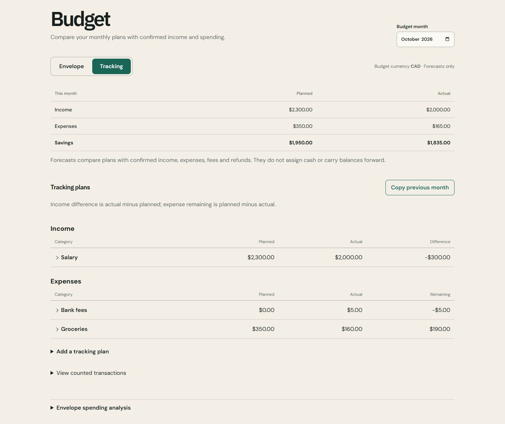
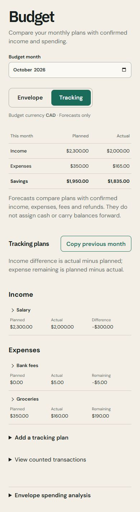
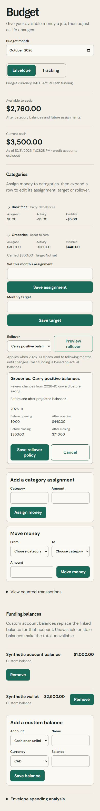
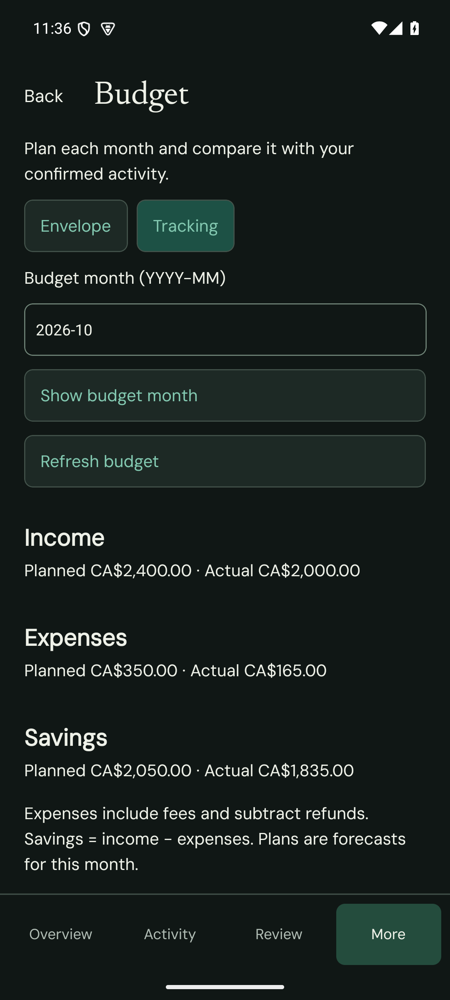
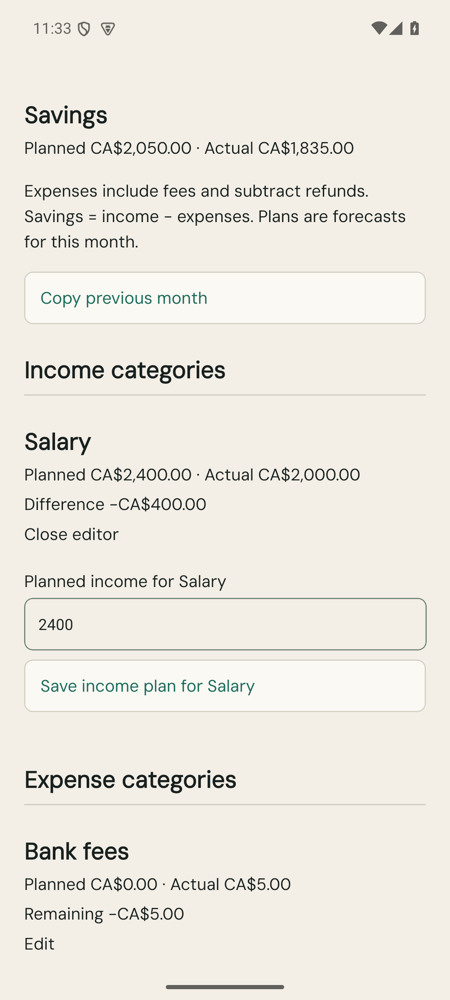
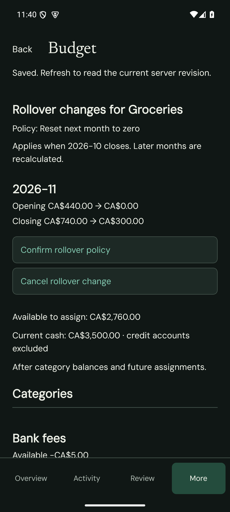
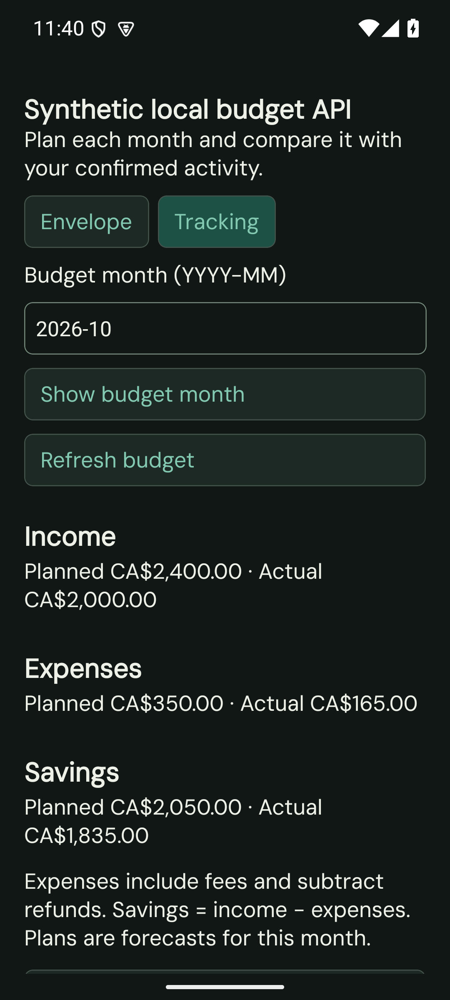

# Tracking budgets and envelope rollover

Budget remains in the existing web navigation and Android More menu. Choose Envelope to assign actual cash, or Tracking to compare a monthly income/expense forecast with confirmed activity. Each ledger remembers its preferred mode; switching preserves both sets of plans.

Tracking plans start without rollover. Copy previous month previews the source plans and requires confirmation before replacing the destination month. Planned savings is planned income minus planned expenses; actual savings includes confirmed income, expenses, fees and refunds. Transfers and provisional/superseded records are excluded. Missing dated exchange rates leave affected actual totals unavailable while plans remain visible. Forecasts do not fund cash. Existing AI analysis continues to use envelope spending aggregates.

Each envelope category can carry everything (existing default), carry only positive balances, or reset monthly. The policy applies when the selected month closes and persists until changed. Historical changes show projected opening/closing balances before confirmation. Source or budget edits invalidate old previews. Resetting a deficit does not add cash; actual balances remain the funding authority.

## Compatibility and rollout

Migration `0032-ai-official-providers.sql` from main is compatible with this change. Tests cover both `0031` then `0032`, and `0032` then the pending `0031`, preserving funded envelopes, targets, cash, encrypted credentials and working tracking/DeepSeek writes. Keep applied migration history intact.

Apply `0031-budget-tracking.sql` with the corresponding Worker release. The migration preserves envelope allocations, targets, funding balances and currency, and initializes Envelope/carry-everything defaults. No production deployment is performed by this PR.

New settings, plan, copy and rollover writes use ledger-wide revisions and operation identifiers. HTTP 409 asks the client to refresh and review again. New clients explicitly request their mode; requests omitting mode retain the legacy envelope view. Legacy settings writes preserve new preferences. Android retains legacy `readView` alongside its mode-aware bridge.

The migration adds revision triggers to existing budget/source tables. A controlled write pause is appropriate between migration application and Worker activation: the earlier Worker uses exact D1 changed-row counts that do not account for these triggers. A rollback must retain the compatible changed-row checks or restore a verified pre-migration backup; do not independently roll back only the Worker to an incompatible version. Existing Android clients remain supported by the updated Worker.

## Verification evidence

Screenshots use synthetic data only. Web checks use the actual Budget components against an isolated local Worker budget handler and SQLite database. Android local-API scenes use the same Budget screen/controller and HTTP endpoints; native journal/transport behavior is separately covered by JVM tests. No real financial provider or AI request is made.

The final repository run passed all 1,303 tests across 198 files. CodeScene per-file reviews and the pre-commit safeguard passed for all 66 eligible source files. Independent implementation and design reviews found no unresolved blocking issues.

### Checked scenarios

- Web: 375/390/1440px, persisted mode and plan edits, copy preview/confirmation, historical rollover preview/save/reload, no page overflow at 390px.
- Final Android APK: Android 35 phone emulator, 1080x2400 (about 411dp), light/dark and 1.3× font. More→Budget, saved 2400 CAD income plan, cold relaunch retained it, hardware Back returned to More. Invalid month feedback cleared after correcting to the current month.
- Android rollover: resetting Groceries after 2026-10 previewed November opening 440→0 and closing 740→300 CAD. Confirmation produced opening 0/closing300 CAD through the actual local API.
- Copy previous month: source/destination months, replacement scope and affected plans were reviewed before confirmation; envelope allocations remained separate.
- Source and rendered native accessibility assertions expose planned/actual/difference or remaining, and envelope assigned/activity/available/carried amounts with currency and unavailable states.
- Emulator font/rotation settings were restored. The crash buffer remained empty. Landscape was inspected on the earlier QA host using the same screen code; no tablet verification is claimed.

The final x86_64 debug APK was built from a physical short-path D: copy with temporary serial CMake and `-g0` options to fit Windows path/memory limits. These build-only options are outside the tracked project configuration. Native codegen, 342 unit tests, lint and APK assembly passed. Web/mobile typechecks, the web production build and the production Android JavaScript bundle passed. The release bundle excludes the debug-only local API scene.

### Screenshots

Synthetic plan values were edited during verification, so captures represent different steps of the test flow.

