# Wealth verification record

Latest: [PR 85 review fixes and architecture refresh](pr85-review/README.md), verified 2026-11-04. The older results below are retained as historical evidence.

Local verification: 2026-11-03. Base: `origin/main` at `1ebfabbaf98e57004709f61510c9f82d7e201319`.

## Environment and scope

Web and Android use the real Wealth Worker handler against a disposable, synthetic D1-compatible database. Android uses the actual React Native shell/screens and Android document picker in the isolated `com.lofuyu.borderledger.probe.wealthqa` debug package on an API 35 emulator. The debug-only fixture supplies a synthetic ledger/session; production authentication and native transport are covered separately by native/API tests. All financial records, exchange rates, and provider responses used here are synthetic.

SDK, AVD, Java, Gradle caches, checkout, and APKs are on D:. Local configuration and signing material are excluded from the branch.

## Local checks

| Check | Result |
| --- | --- |
| Complete repository suite, including mobile tests | 213 files / 1,533 tests passed, 553.73 seconds |
| Final web regression suite after signed-chart and explicit-zero refinements | 51 passed |
| Final Android opening-date and secure-ID regressions | 19 passed after the complete-suite run |
| Root and mobile TypeScript | Passed |
| Production web build | Passed; Vite reports a 529 kB chunk-size advisory |
| Android unit tests | 359 passed, zero failures/errors |
| Shared Android host tests | 19 passed |
| Android lint and normal debug build | Passed |
| Android release build | Passed, unsigned x86_64 artifact |
| Android static/toolchain gate | Passed |
| Normal debug and release merged host/manifest checks | Passed |
| CodeScene per-file reviews | Completed for supported source files |
| CodeScene safeguard | Initial full-feature gate failed; follow-up change gate passed |

The complete suite includes the final store/report/FX module extraction, secure native UUID bridge, API/CSV guards, correction dates, signed charts, explicit zero values, FX provenance, missing coverage, and focused Android Back handling. The subsequent Android dated-opening fix passed 19 focused tests, both typechecks, and a fresh release build.

## Browser flows

Verified at 375, 768, and 1440 CSS pixels without horizontal page overflow. Keyboard Enter opens the history data table; incomplete dates expose a Coverage column and known-subtotal labels.

- Created a manual asset and debt, renamed the asset, and added a backdated asset value.
- Changed a zero-valued brokerage aggregate to holdings and back with dated opening values. Historical reports preserve the representation at each date.
- Imported a custom-header CSV through mapping, preview, and atomic confirmation.
- Downloaded the 43-column template and canonical export. The opening export contained 19 records, including both mode transitions.
- Reimported the original 10-row portfolio CSV: all 10 rows were detected and skipped as duplicates.
- Inspected holding/account event and valuation history, cash balances, allocation, gains, and confirmed cash flow.
- Selected a correction target and verified typed prefill for the original security, quantity, basis, and date.

After the trading/correction/split scenario, the web showed six RY shares with CAD 306 basis, CAD 56 realized gain and CAD 84 unrealized gain. The CAD portfolio return was 10.48%; final net worth was CAD 2,746.75 plus USD 900 and confirmed household net flow was CAD 1,761.75. Internal trades and transfers were excluded from household income/spending.

Opening portfolio values were CAD 1,400 and USD 900. With the manual asset of CAD 1,500 and debt of CAD 300, net worth was CAD 2,600 plus USD 900. Confirmed household cash flow was CAD 1,755 before the investment activity scenarios.

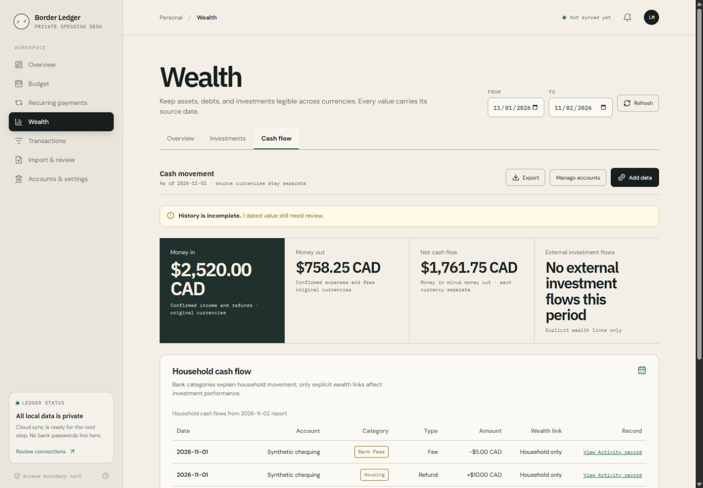

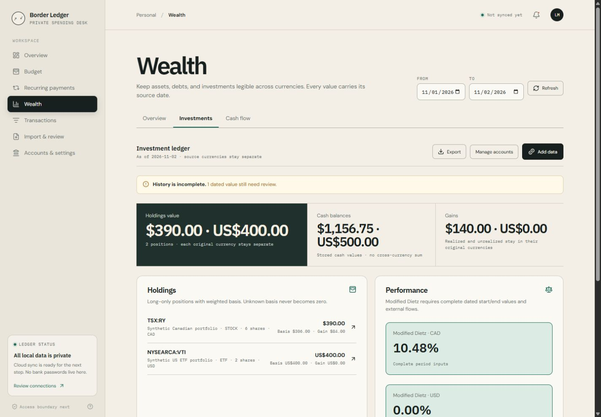

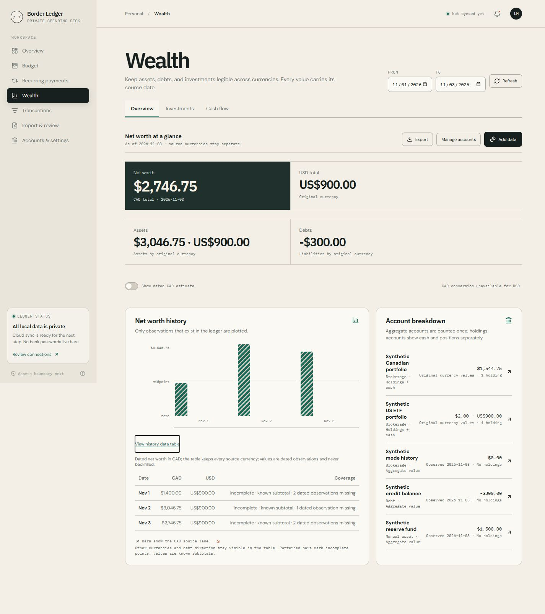

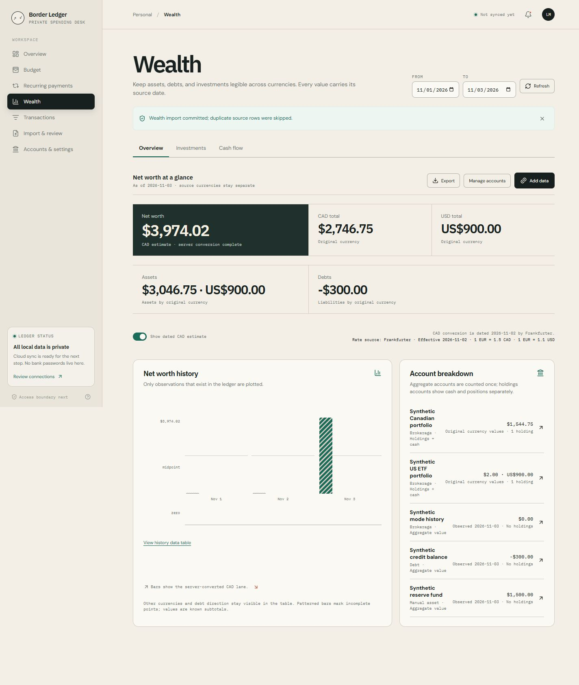

The full 29-record canonical export was restored through the web preview/commit flow. The resulting export was byte-identical to both the API backup and actual Android SAF export (SHA-256 `D688799F7065805C4ED759B90ED73EB600698E2441E05B291B4F0BCC96B5D42D`). Positions, cash, totals, returns, and cash-flow results matched before/after for both report dates. See [the complete synthetic portfolio](synthetic-complete-portfolio.csv); use it only in a disposable QA ledger.

With valid synthetic FX, the November 3 CAD estimate was 3,974.02, using actual November 2 Frankfurter observations: `1 EUR = 1.5 CAD`, `1 EUR = 1.1 USD`. The November 2 report kept the complete CAD estimate unavailable because its debt value was missing, despite valid FX rates.

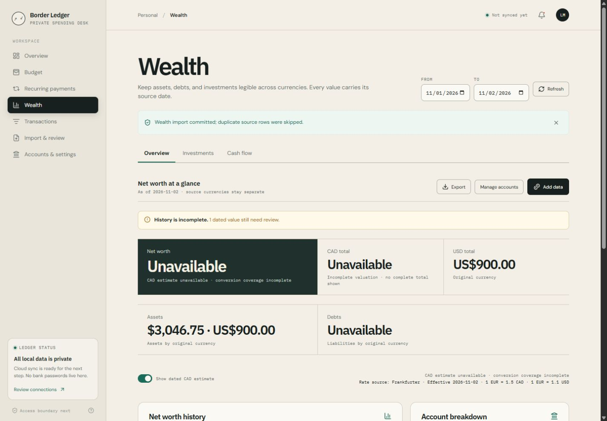

## Android emulator flows

The mandatory local emulator acceptance matrix passed on API 35 using the real native shell, document picker, and Worker routes.

- Created and imported the portfolio through Android SAF: 10 valid opening rows; repeated imports skipped duplicates. Downloaded the template and exported the complete 29-record portfolio.
- Recorded buys, partial sells, dividends, fees, withholding, splits, linked internal transfers, corrections, and dated manual prices. Invalid buys/sells displayed validation errors.
- Verified RY quantity 6, basis CAD 306, market value CAD 390, realized gain CAD 56, unrealized gain CAD 84; VTI quantity 2 with USD 400 basis/value. CAD return was 10.48% and USD return 0%.
- Verified net worth CAD 2,746.75 plus USD 900, CAD estimate 3,974.02 with actual November 2 FX dates, cash flow, account/security histories, and persistence after force-stop/relaunch.
- Removed only the emulator's API reverse mapping to exercise the Wealth error and Retry flow. Restoring the mapping and selecting Retry recovered unchanged values.
- Checked light/dark themes, font scales 1.3 and 2.0, keyboard dismissal, TalkBack activation/focus and portfolio details, and Back navigation. The native-stack focus regression also has automated coverage. Restored light theme, normal font size, and disabled TalkBack after testing.

The filtered runtime log contains no fatal exception, fatal signal, TypeError, ReferenceError, or invalid accessibility-role errors. All screenshots and logs contain synthetic data.

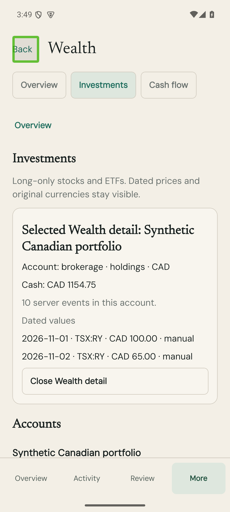

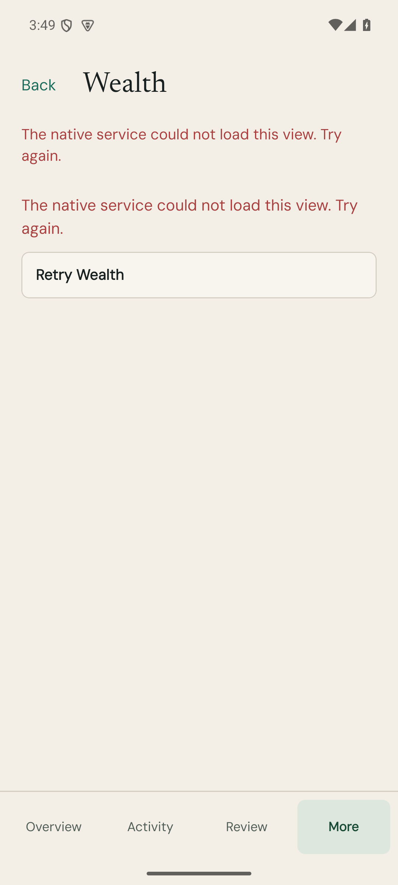

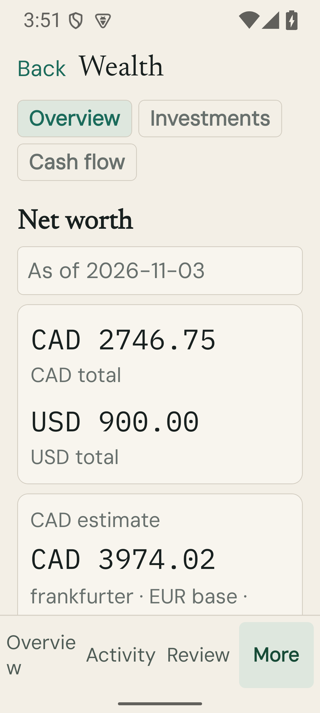

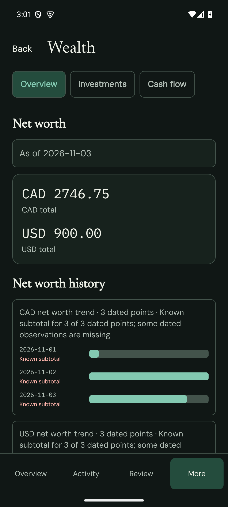

See [the filtered emulator log](android-logcat.txt).

### Follow-up native verification

CodeQL's weak-randomness findings were fixed with synchronous native UUID generation; a regression also proves the native path works with JavaScript crypto absent. The actual emulator saved a new account and retained it after force-stop/relaunch.

The follow-up check caught an undated Android opening amount. New aggregate openings now expose a date and save a true observation, including zero. The actual Android form saved `Synthetic dated UUID zero` with a November 3 zero observation; server coverage was fresh, no missing-data reasons remained, and CAD/USD totals and the CAD 3,974.02 estimate stayed unchanged. The updated release build passed. New holdings accounts direct users to dated opening cash/position activity instead of accepting an undated balance.

The restored benchmark was also imported through the final extracted store/report modules; the canonical 29-record export retained the same SHA-256 listed above. A subsequent zero-valued regression account is additional synthetic QA data.

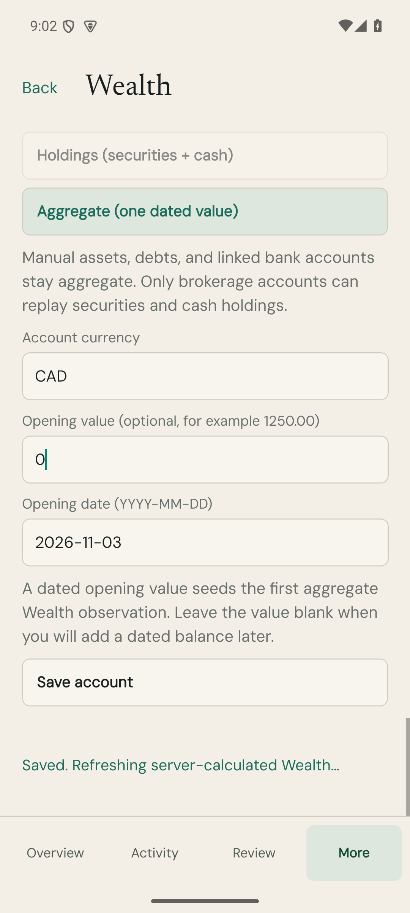

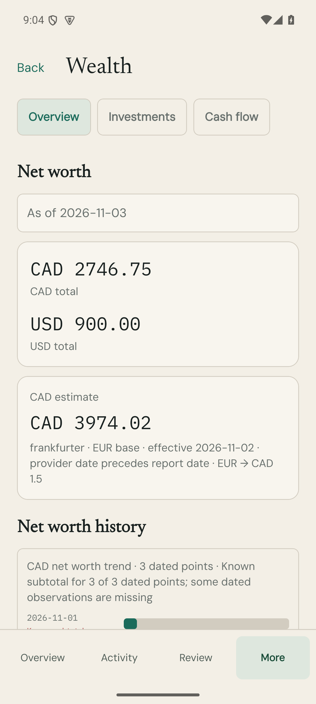

The web account-form refactor also saved an explicit zero through the actual browser and retained complete totals.

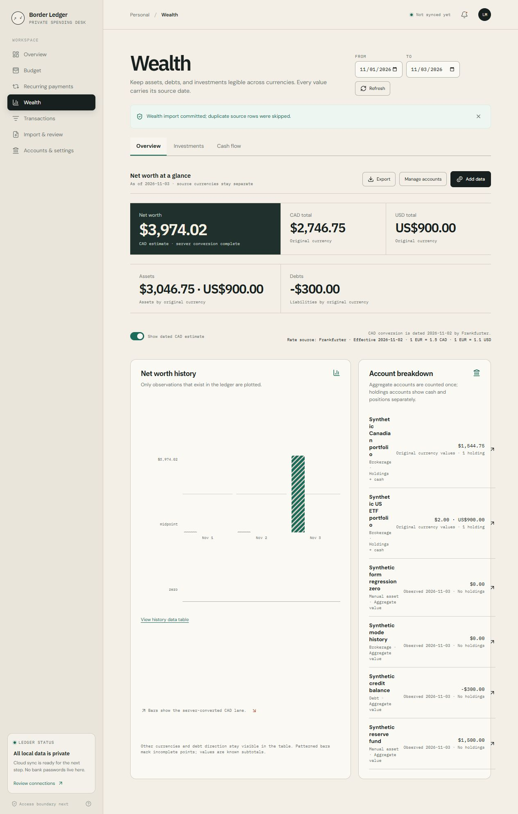

## CodeScene findings

The initial safeguard checked 87 supported files. The oversized native service was refactored and now scores 10.0. Accounting, persistence, import, quote, and web logic received clean local per-file reviews. Hosted analysis additionally flagged FX conversion complexity, store size/function count, quote lookup complexity, and account-form argument structure; those prompted cohesive FX/cash-flow/report module extraction and form/lookup refactors. Existing complexity in Worker entry/mobile routing remains stable or improved.

The initial whole-feature gate was **failed** for primitive/string-heavy arguments in these seven native boundary/controller/test files:

- `mobile/src/screens/WealthScreen.tsx`
- `mobile/src/features/wealth/WealthController.ts`
- `tests/mobile-wealth-flow.test.ts`
- `android/app/src/main/java/com/lofuyu/borderledger/wealth/WealthRepository.kt`
- `android/app/src/main/java/com/lofuyu/borderledger/react/WealthModule.kt`
- `android/app/src/main/java/com/lofuyu/borderledger/react/WealthExternalDocumentOperations.kt`
- `android/app/src/main/java/com/lofuyu/borderledger/auth/CredentialInterceptors.kt`

These reviewed findings concern the string-based React Native/HTTP/document operation contracts. The follow-up pre-commit gate passed for 15 supported changed files; final whole-branch/hosted status is recorded in the PR. See the [machine-readable safeguard result](codescene-precommit.json). Branch-level analysis compares the final commit against `origin/main`; its result is recorded in the PR.

## Limits and rollout

Live Alpha Vantage verification was not performed because no user key was supplied. Provider success/failure, dated quote retention, encryption, quota, and stale-response behavior are tested with mocked provider responses. Manual/CSV workflows require no provider key.

The inherited mobile dependency audit has four low and two high findings. The high advisories concern `body-parser` and `joi` through React Native CLI tooling; this feature does not change dependency manifests or locks. The complete audit is retained in the local QA logs.

Apply migration `0033-wealth.sql` before enabling the new Worker routes. Configure an independent `WEALTH_CREDENTIAL_ENCRYPTION_KEY` only when enabling saved market-data credentials. Existing Android sessions may require fresh sign-in for `wealth:read` and `wealth:write`. See [the feature/operator guide](../../features/wealth.md). Production deployment and merge are not part of this verification.
