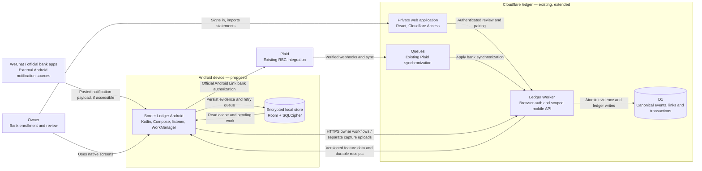

# Border Ledger Android — architecture, notification semantics, and UX design

Date: 2026-10-13. Revision 2: animated login, full website feature parity, shared visual identity, and complete dark-mode support. Status: proposed design for the requested planning stage; no application implementation is authorized by this document alone.

## Decision and intent

Build an installable Kotlin/Jetpack Compose Android application for the user's Pixel 10 Pro. It captures usable Bank of China WeChat notifications, keeps a durable encrypted upload queue, and provides every functional website workflow through Android screens backed by the existing Cloudflare ledger: spending, recurring payments, transactions, imports/review, account connections, exports, and settings. Include an authored animated login screen, the same Border Ledger identity, and System/Light/Dark appearance across the entire application. Add CMB through an independently verified source adapter when its account type and notification payload are known.

Keep the original architecture: one Cloudflare Worker with D1, existing Plaid synchronization for RBC, GitHub delivery, and statement reconciliation. The important extension is **Chinese-bank monitoring across currencies**, rather than assuming every BOC alert is a CNY bank debit. The supplied screenshots show a credit-card conversation, purchase notices, cancellations, failed attempts, and CAD/USD/HKD amounts.

The user owns product decisions, bank enrollment, phone permissions, and release credentials. The implementation owner owns Android, Worker, migration, security, and verification work; these responsibilities may be held by one engineer. Recommendations below are design calls, not claims that the user has approved every implementation detail.

## Evidence and unresolved facts

| Evidence | Implication |
|---|---|
| Read the complete referenced chat, **Plan cross-border spending tracker**, thread `01a12f6e-4909-7a41-a0a6-94cb42f8f606` | Preserve RBC/Plaid, Cloudflare/GitHub, Kotlin capture, provisional alerts, and statements as the reconciliation source. |
| Existing repository: React/Vite website, Worker, D1 migrations, Plaid and recurring features | Extend the application; do not rebuild bank synchronization or create another backend. |
| User identified a Pixel 10 Pro | Physical acceptance testing targets this phone. Its installed Android and WeChat versions must be recorded during discovery. |
| Four user-supplied screenshots of the BOC credit-card WeChat conversation | Formats and financial event types are real evidence; they are **not** evidence of what Android notification extras expose. |
| BOC messages include CAD, USD, HKD; user says other currencies occur | Support a multi-currency credit account and a currency registry. Do not infer account currency from bank country or card suffix. |
| Screenshot message separators and bank times differ by approximately twelve hours across a date boundary | `Asia/Shanghai` source time and `America/Toronto` display time are a plausible explanation. Verify the source timezone; do not subtract a fixed twelve hours. |
| Muted bell shown beside the BOC conversation title | Test whether this conversation currently posts Android notifications. Muted in-app messages may never reach a listener. |
| User explicitly says a transaction notification received at local midnight represents a transaction at local midnight | Live reporting uses the original notification posting timestamp in the selected reporting timezone. Bank-card wall time is preserved separately and cannot shift that transaction into another day. |
| User now requires every website function, an attractive flowing login screen, matching themes and dark mode | Full feature parity is a release gate. Native import/export, recurring analysis and bank management are required; decorative login motion is explicitly requested and remains bounded to that surface. |
| Current TypeScript types, imports, providers, SQL CHECK constraints and displays assume CAD/CNY | Multi-currency support requires a compatibility migration and changes across the existing web/domain/reporting stack. |
| Existing report route aggregates a transaction read limited to 500 records | New authoritative reporting must aggregate the complete selected dataset independently of list pagination. |
| Existing `transactions.fingerprint` is globally unique and is used for import merging/provider upserts | Replace fingerprint identity with source-record identities; a resemblance fingerprint becomes a nonunique matching aid. |

Open facts: BOC account region, actual source timezone, whether alerts represent authorizations or postings, accessible notification fields, actual statement formats, CMB debit versus credit account and channel. None is silently considered resolved. Screenshots and actual notification capture are complementary evidence.

Do not copy raw screenshots, real card suffixes, merchants, dates, amounts, or notification dumps into GitHub. Use synthetic fixtures with the same structure. Real diagnostic samples stay on the phone or in a user-approved local private location.

## Research: should the monitoring approach change?

Research checked on 2026-10-13; use primary documentation. Conclusions are limited to documented capabilities, not a claim that no other service exists.

| Option | Finding and tradeoff | Decision |
|---|---|---|
| WeChat notification listener | Android provides notification callbacks and access to currently active notifications. Delivery and exposed content depend on Android, WeChat and channel settings. | Primary path, subject to a Pixel capture test. [Android listener reference](https://developer.android.com/reference/android/service/notification/NotificationListenerService) |
| BOC banking-app notifications | BOC documents opt-in debit- and credit-card transaction push messages. A dedicated app source may be easier to filter than a shared messaging app, but its exposed text must also be tested. | Optional fallback adapter; do not switch without better capture evidence. [BOC information policy, message settings](https://www.boc.cn/aboutboc/ab1/202504/t20250409_25316940.html) |
| CMB WeChat or banking-app alerts | CMB identifies its credit-card WeChat account, CMB app and Palm Life app as transaction-alert channels. Its published SMS policy has thresholds and changes with WeChat enrollment. This does not establish debit-card coverage. | CMB is plausible for credit cards. Verify account/channel and sample notifications; use the same pipeline with a separate parser. [CMB credit-card alert notice](https://cc.cmbchina.com/notice/20230828gg.htm) |
| Direct BOC account API | The documented open-banking offering examined is a corporate/partner service; it does not demonstrate self-service personal transaction access. | No unsupported consumer-API dependency. Reconsider if the bank provides suitable personal access. [BOC corporate open banking](https://www.boc.cn/english/enterprises/trb/osc/202601/t20260109_25641179.html) |
| Plaid for Chinese banks | Published Transactions coverage includes Canada and other listed regions; mainland China is not listed. Global identity verification is a different product. | Preserve Plaid for RBC, not as the proposed BOC/CMB solution. [Plaid coverage](https://support.plaid.com/hc/en-us/articles/27895826947735-What-Plaid-products-are-supported-in-each-country-and-region) |
| Bank exports | BOC has documented downloadable transaction history in PDF form. The current application accepts CSV; the user's current export must be inspected before claiming a working backstop. | Required reconciliation path. Add the adapter for the actual file, including text PDF if necessary. [BOC export announcement](https://www.boc.cn/aboutboc/bi1/202105/t20210512_19387144.html) |
| SMS | BOC's published free-SMS policy includes an adjustable transaction threshold. Messages can therefore be incomplete without correct settings; Android also restricts some sensitive notification content. | Later fallback only; no SMS inbox permission in the first release. [BOC SMS policy](https://www.boc.cn/pbservice/bi2/202503/t20250327_25305719.html) |

**Recommendation:** retain WeChat capture plus statements. Test the official bank-app channels alongside it during feasibility. Choose one primary notification channel per instrument in the first release; enabling duplicate channels without reliable linkage can inflate provisional totals.

Android 15 introduced OTP-related notification redaction; a notification listener cannot promise unrestricted content. Sideloaded applications may also encounter restricted-setting steps. WorkManager provides persistent retryable work, not a precise immediate-upload guarantee. These constraints belong in onboarding and health states. [Android redaction](https://developer.android.com/about/versions/15/behavior-changes-all), [restricted settings](https://support.google.com/android/answer/12623953), [WorkManager](https://developer.android.com/develop/background-work/background-tasks/persistent)

## Scope and technology decisions

| Decision | Rationale | Reconsider when |
|---|---|---|
| Kotlin + Compose + Material 3; one Android application module with feature packages | Direct access to notification services, native settings/navigation, and testable lifecycle behavior; matches the original Kotlin plan. | A demonstrated need for another mobile platform outweighs native capture integration costs. |
| Native screens for every website workflow; official Android Plaid Link; system browser only for identity/bank-provider authorization and external help | Full parity is the user's requirement. Imports, exports, recurring analysis, account selection and settings must complete inside the app. | A verified provider flow requires an external authorization surface; this does not replace the app's own workflow. |
| Room + current SQLCipher for Android + Android Keystore | Encrypt financial cache, approved notification evidence, and outbox together. SQLCipher has a maintained Android/Room integration. | A tested replacement provides equivalent confidentiality and migration behavior. [SQLCipher Android](https://www.zetetic.net/sqlcipher/sqlcipher-for-android-community/) |
| Coroutines/Flow and WorkManager | Keep callbacks short, expose observable state, and retry durable work after connectivity/restarts. | Measurements show a requirement unsupported by these APIs. |
| REST mobile namespace with separate interactive owner sessions and narrow background capture credentials | Full account management requires authenticated user authority. Capture credentials remain restricted even while the app is closed. Existing browser paths retain Access/origin checks. | A supported identity product removes the need for the current Access-to-native session broker. |
| D1 is the canonical ledger; the phone is a capture source and encrypted read cache | One authority prevents contradictory totals between phone and website. | A future offline-edit requirement justifies a conflict protocol. |
| Direct atomic ingestion for bounded alert batches | Durable evidence and its ledger projection can be committed together before acknowledgement. Existing Queues remain responsible for Plaid work. | Measured ingest cost/latency requires a durable receipt plus a separately recoverable processor. |

WeChat/source notifications must support any currency in the validated ISO currency registry, not just CAD, CNY, USD or HKD. The registry carries minor-unit metadata so adding a registered currency does not require another database-table rebuild. Unknown codes or an ambiguous `$`/`¥` enter review; never default them to CAD/CNY. No conversion is needed to provide useful source-currency totals. A combined estimate is a later, explicitly labeled view with recorded rates and coverage; missing rates never become zero.

Proposed minimum Android API is 26; the shipped device class is phones, with Pixel 10 Pro as the physical acceptance device. Lock current mutually compatible stable SDK, AGP, Kotlin, Compose, Room, SQLCipher, WorkManager and JDK versions during the first build task. Do not use floating dependency versions or assume the phone's installed OS from its model name.

First release requires animated login/user sessions, every website function mapped below, native import/export and Plaid/account workflows, reliable notification capture/upload, currency-safe reports, System/Light/Dark themes, and statement reconciliation. CMB capture remains conditional on verified samples. Screenshot OCR, budgets, AI categorization, chat-history scraping and public multi-user distribution are later work unless a website feature inventory proves they already exist. No AccessibilityService, root, WeChat database access, bank-password collection, READ_SMS, exact alarm or perpetual foreground service is required. The early feasibility APK remains a debug milestone; it is not the full-parity release.

## Website-to-Android parity contract

Inventory inspected: `src/App.tsx`, `src/components/RecurringView.tsx`, `RecurringDetails.tsx`, domain export/recurring modules and Worker routes. These are actual repository functions, not inferred from marketing copy. Freeze/recheck this inventory before implementation and release; a new website function must gain a mapped Android workflow or remain an explicitly unresolved release requirement.

| ID | Website function | Android completion criterion |
|---|---|---|
| F01 | Private workspace access/profile | Authenticated native login, identity display, session recovery and explicit sign-out; the signed-out screen never exposes cached financial content. |
| F02 | Today/Week/Month spending and confirmed/provisional lens | Equivalent native report controls, source-currency totals, trends and confirmed/provisional distinctions using shared reporting rules. |
| F03 | Daily/weekly/monthly chart range | Native charts and range selection, accessible text/table alternative, equivalent full-window data and truthful freshness. |
| F04 | Transaction search and currency/category/state/source filters | Native searchable/filterable/paginated activity; details/provenance and category/note editing with save, revision conflict and recoverable errors. |
| F05 | CSV ledger export | Export all ledger rows through Android Save/Share, with source currency, state and notes. Selection explicitly says All records or Current filter; no list-page truncation. |
| F06 | Statement file/account selection and preview | Android document picker, real accounts, 10 MiB limit, required-column mapping, row errors, duplicate candidates and native preview. Support CSV plus the verified BOC format. |
| F07 | Commit import and review queue | Confirm selected rows, idempotent durable server commit, progress/resume/cancel-before-publication, and native matching/classification review. No website detour completes this function. |
| F08 | Accounts, institution/currency details and freshness | Native account list/detail with multi-currency metadata, source status, last successful bank sync and capture/upload status. |
| F09 | Plaid connect and explicit selected-account confirmation/cancel | Official Android Plaid Link; backend exchanges the temporary public token, retrieves authoritative accounts, then verifies selected IDs before permanent mapping/storage. Native cancel commits no account mapping and cleans up any known temporary provider Item. |
| F10 | Refresh bank data and disconnect a connection | Native controls using owner-authorized operations; visible queue/provider errors; disconnect revokes provider access while preserving ledger history. |
| F11 | Recurring list, currency/classification filters and Load more | Native recurring screen with all pages and the same stored-source availability/coverage/stale/error states. |
| F12 | Recurring monthly/yearly run rate and posted actual cost | Native per-currency source estimates, subscription/bill distinctions, actual posted cost and excluded-stream behavior; estimates never become ledger transactions. |
| F13 | Upcoming payments, amount changes, stream details/history and classification editing | Native upcoming/change sections and details with explicit expected/actual amounts, source status, posted member history and save/error handling. |
| F14 | Reporting timezone, week start and reporting-currency preference | Persist timezone/week start/preferred summary currency through a shared server preference record; theme/filter state stays device-specific. Preferred currency controls focus/order, not an implicit FX conversion. |
| F15 | Review notices, profile/account help and reporting-policy explanations | Native notices/detail links and About/help pages with the same useful information; state/data come from real services. |
| F16 | Public introduction and clearly labeled representative preview | Native About/optional sample-ledger view accessible before login. Demo is isolated, visibly synthetic and never an authenticated error fallback. |
| F17 | Existing website's shared domain/provider/import/export semantics | Both clients use common Worker/domain services and equivalent fixture assertions; existing RBC/Plaid and recurring behavior remains correct. |
| F18 | Requested native theme/login/capture additions | Flowing login, all-app dark mode, notification onboarding/health, offline upload and verified BOC/CMB capabilities complement the entire parity set. |

Observed gaps to close rather than reproduce: the website import button currently merges preview rows locally while a commit endpoint exists; native import must persist, and the web path should use the same durable service. Reporting preference controls include UI-only state; shared persistence must supply a real meaning. Current export/report list limits must not lose older records. No functional FX conversion control was found in the private workspace: a future combined estimate remains separately specified, and marketing references do not become fabricated live rates.

Release requires every F01–F18 row to have a reachable Android path, real service behavior and acceptance evidence. System browser/Custom Tabs are appropriate for Access identity and provider-required bank OAuth; the application owns the surrounding workflow. A link opening the website's import, recurring, export or accounts screen does not satisfy parity.

## Interactive login and session architecture

Keep Cloudflare Access as the trusted identity boundary. Create a native login/session broker on the Worker, rather than handing a browser cookie or global service token to Android. Cloudflare Access is not assumed to be a general-purpose native OAuth issuer. Use the same configured Access identity method; do not invent password storage, signup or a new identity-provider account. The native screen's primary action is **Sign in securely**; provider verification occurs in a system browser, then returns to the native app.

1. Android creates a cryptographically random state and PKCE S256 verifier/challenge; start a ten-minute login request bound to the app instance, fixed redirect URI and canonical environment.
2. Open the Access-protected owner-authorization page in Custom Tabs. The Worker verifies Access JWT issuer/audience and the approved identity policy, then an explicit Continue-to-app approval binds the subject to ledger `personal`.
3. Issue a single-use two-minute authorization code bound to the request, PKCE challenge, approved subject and device. Return through verified HTTPS App Link `https://pf.lofuyu.com/android/auth/callback`; the registered package/signing fingerprint is published at `/.well-known/assetlinks.json`. State/host/path must match. Callback cancellation/failure remains a recoverable native state.
4. Exchange code + verifier over HTTPS for opaque native owner access/refresh tokens; tokens never appear in URLs, clipboard, query logs or Android build files. Atomic code consumption prevents a second owner session. Cache only an encrypted exchange response for 60 seconds keyed by the identical request/idempotency digest, so a lost response can be recovered without a new grant.
5. Access lifetime is 15 minutes. Refresh absolute lifetime is 24 hours by default, or 30 days when Stay signed in is explicitly selected; no indefinite sliding extension. Refresh rotates per family through a single-flight native session manager, with an encrypted 60-second identical-request replay response. A conflicting/reused refresh outside that bounded replay revokes the family.
6. Store tokens under Keystore-protected encrypted storage; the Worker stores hashes and revocation state, using a dedicated `MOBILE_SESSION_ENCRYPTION_KEY` for short response-replay encryption rather than Plaid's key. Check scope/expiry/revocation on every request. Recent owner approval within ten minutes is required for disconnecting a bank, revoking another device or exporting the complete ledger; this is explicit Access-backed owner approval, not a claim of a new MFA challenge.
7. Grant only server-owned owner scopes: `ledger:read`, `ledger:review`, `imports:write`, `exports:read`, `recurring:classify`, `connections:manage`, `preferences:write`, `devices:manage`. A separate opt-in capture credential grants only selected-source/instrument/currency `alerts:write` and its own limited receipt/health status. An owner login does not silently enable notification access or background monitoring.
8. Normal app closure or owner-session expiry can leave explicitly enabled background capture running. Explicit Sign out pauses local monitoring, revokes owner-session family and this device's capture credential, hides/clears financial read cache and retains unsent alerts encrypted for same-ledger recovery. Offline sign-out is immediate locally; encrypted revocation-only intents complete when connectivity returns. Show pending remote revocation rather than claiming it happened offline. Re-authentication cannot upload old queued records outside newly approved source scope.

At owner-session issuance and each capture-credential issuance/renewal, return a separate random 32-byte revocation capability bound to that exact owner-session family or capture-credential generation. Its expiry covers only the associated grant's remaining lifetime; hash it separately on the server and accept it only at the revocation endpoint. It cannot read data, refresh tokens or approve any other action. Offline Sign out erases owner access/refresh credentials and retains only these capabilities in the encrypted revocation outbox. A delayed request can revoke the old family/grant, never a newly issued family/grant. Online logout uses the same idempotent operation and clears acknowledged capabilities.

Owner and capture credentials are distinct in storage, authentication code and route tests. Owner tokens authorize the new mobile feature endpoints, never bypass old browser/Access guards. Browser endpoints, Plaid webhooks and canonical-origin restrictions retain their existing authentication paths. Android background upload cannot obtain account-management privileges by refreshing or substituting a capture token.

Remembered offline reading is narrowly defined: only the previously signed-in, same-ledger owner may view an encrypted snapshot while the device is currently unlocked and the local lease remains valid. Lease ends at the earlier of absolute refresh expiry or 24 hours after last successful server authentication/refresh. No cached view on first login, explicit sign-out, known revocation or lease expiry. Offline reads display snapshot time and cannot authorize any server mutation; recheck revocation on reconnect before refresh/writes. Remote revocation is not claimed observable while the phone is offline.

Native imports use canonical staged previews and row identities: maximum file size 10 MiB, preview lifetime 24 hours, bounded row chunks and an explicit final publication barrier. Partial/staged imports never enter reports. Session-expired/interrupted uploads resume under the same owner/file/row/operation identity after authentication; cancel-before-publication removes staging, not ledger history. Both clients share validation/reconciliation; native CSV is required and the actual BOC additional format is a source gate. Native CSV export streams all/filter-scoped canonical rows using correct currency scales and safe text quoting, then Android Save/Share writes only the user-authorized export destination.

External-browser authorization and PKCE/App Links follow native-app security practices; the broker's Access integration and revocation protocol require their own tests. [Native authorization guidance](https://www.rfc-editor.org/rfc/rfc8252), [Android App Link verification](https://developer.android.com/training/app-links/verify-applinks), [Cloudflare Access web applications](https://developers.cloudflare.com/cloudflare-one/access-controls/applications/http-apps/)

The official Android Plaid SDK is required for native bank linking. Its backend link-token request includes the registered `android_package_name`; the app receives a Link token/public token, never a Plaid access token or secret. Account selection/exchange, update/reconnect where the source requires it, synchronization and disconnect reuse existing server services with owner authorization. [Plaid Android Link](https://plaid.com/docs/link/android/), [Plaid update mode](https://plaid.com/docs/link/update-mode/)

Native Link uses a backend pending-connection stage: exchange public token on the server, encrypt the returned provider access token, retrieve authoritative account metadata, and show native selected-account confirmation. Pending selection expires after 15 minutes; confirmed selection publishes only verified mappings. Cancel/expiry initiates provider Item removal and deletes pending credentials after confirmed cleanup; uncertain provider/DB outcomes are tracked visibly for retry/review. Provider Link can create an Item before native confirmation, so do not promise cancellation prevents all provider-side Item creation or restores provider connection quotas. No temporary Item is presented as a confirmed ledger connection. This same guarded core supports the existing browser flow.

## Architecture and ownership

Audience: the implementer locating trust and deployment boundaries before changing capture or reporting. C4 container-level view; internal parser classes are intentionally omitted. Labels carry meaning without color. The phone is proposed; the web/Worker/D1/Plaid foundation already exists. Capture completeness remains unproven until hardware testing.

Text fallback: external notifications enter Android; approved evidence and the outbox are encrypted locally. Android uploads normalized events using a narrow capture credential. The Worker authenticates it and atomically writes evidence/projection into D1. Separately, an Access-backed native owner session authorizes the app's complete ledger, recurring, import/export, account and settings workflows. Both clients reuse canonical services. Plaid/Queues remains a bank-source path; bank authentication uses the official Android Link SDK where needed.

Diagram review: standard Mermaid flowchart source reviewed for boundary/relationship consistency; intended renderers are Codex/GitHub Markdown. No standalone rendering test has been performed during planning. The text fallback is authoritative if a renderer cannot display it.

| Boundary | Authority and owner |
|---|---|
| Source profiles and instrument mapping | Owner approves each bank/channel/card mapping; Worker owns the approved scope. Android may propose a match, never expand scope. |
| Notification capture/parser | Android owner; best-effort source evidence with explicit precision and confidence. Sender display names are not cryptographic bank authenticity. |
| Local queue/cache | Android owner; committed local state survives retries, app restart, and upgrades. It does not establish bank confirmation. |
| Event lifecycle and reconciliation | Worker/domain owner; owns links, voids, refunds, annotations, and the single counted projection. |
| Bank records | Existing Plaid/import owner; statements and provider records supply confirmation. |
| Reporting | Shared ledger domain/Worker owner; native formatting cannot introduce different counting rules. |
| Owner login, capture pairing, sessions, releases and recovery | Worker/Android/platform owner; separate owner/capture authorization, public verified app-link files, revocation and user-held account/signing-key custody. |

## Domain: separate bank events from counted spending

Do not feed every parsed amount into `Transaction`. Introduce an immutable **bank alert event**, a lifecycle/link record, and a derived counted transaction where appropriate. Keep the existing transaction categories and confirmation states as the reporting projection; event semantics are an additional layer.

### Event decision table

| Observed label or event | Interpretation | Contribution and handling |
|---|---|---|
| `交易提醒` with `消费` | Purchase notice; exact authorization/posting semantics remain source-profile evidence | Eligible provisional purchase when fields, instrument and date are resolved; never automatically confirmed. |
| `交易失败提醒` | Failed/declined attempt | Zero spending. Retain an optional non-spending activity event. Never cancel a separate successful purchase of the same amount. |
| `撤销` | Cancellation/reversal notice | Zero standalone spending. Link through a strong reference or explicit review. Full cancellation voids an unposted purchase; a verified partial cancellation reduces its remaining provisional amount. An unmatched reversal waits in review. |
| Explicit posted refund / `退款` | Refund evidence, separate from a void | A confirmed bank refund reduces net spending once. A notification alone stays provisional/review; preserve linkage if known and support partial refunds. |
| Preauthorization / adjustment / completion | Potential hold, replacement or settlement | Hold is separate from spending. Use a lifecycle link to replace amounts; do not sum hold plus completion. Unknown variants enter review. |
| Repayment, own-account transfer, wallet funding | Movement/repayment rather than a new purchase | Exclude from spending; cash-advance principal is reviewable and separate from any fee. Do not classify every debit as an expense. |
| Fees and interest | Distinct potential expenses | Count only the identified fee/interest event, avoiding an included-total duplication. |
| Unknown type, missing currency/date/account, truncation | Insufficient evidence | Needs review; exclude from both confirmed and provisional spending until resolved. |

`撤销` is deliberately not mapped to `refund` by a keyword rule. The BOC guide also distinguishes authorization holds from later settlement. These rules are conservative application decisions, not a claim that every BOC reversal has identical settlement behavior. [BOC credit-card guide](https://www.boc.cn/bcservice/bc3/bc31/201106/t20110607_1414163.html)

### Money, account and time invariants

1. Store original event amount/currency; amounts are integer minor units using currency metadata, not binary floats. Preserve purchase, authorization and billing money separately when a source provides more than one amount. Statements decide the actual posted billing amount; cross-currency linkage requires a bank reference or review, not an estimated exchange rate.
2. One BOC card can have several currency balances. Keep one funding instrument/account with permitted currencies; do not create unrelated cards for each currency or change its currency after each alert. Existing RBC single-currency accounts remain compatible.
3. Resolve instrument by approved source profile + bank + card/account hint. Currency is not account identity. A four-digit suffix alone is not globally unique. Missing/colliding hints enter review unless an explicit user-approved unambiguous mapping applies.
4. Store `notificationPostedAt` (original Android posting timestamp) and `capturedAt` (listener processing timestamp) separately in UTC. For a verified individual message timestamp, retain that message's original posting timestamp; otherwise use its first identifiable notification posting time. Preserve bank-displayed local date/time, zone, precision and year provenance independently, plus bank transaction/posting dates from imports. Do not assign one summary-update time to old embedded messages without individual timestamps.
5. Default report timezone is `America/Toronto`, week starts Monday; expose these preferences and calculate through IANA timezone rules. Verify the BOC profile's source timezone; `Asia/Shanghai` is an evidence-based hypothesis. Canada switches offsets, so the observed twelve-hour gap is not a reusable arithmetic offset.
6. A new live alert has its year from the original notification timestamp, even when the bank card omits the year. Any inference of the separate bank-displayed year considers adjacent years within seven days before notification posting through five minutes after posting; unresolved bank-clock metadata must not invent or replace the live timestamp. Historical pasted cards/imports need an explicit date/year context and cannot be assigned today's time. Preserve two-digit-year provenance.
7. Reporting date basis for live alerts: original individual notification posting instant in `America/Toronto` by default, honoring the user's instruction that receipt at midnight is a transaction at midnight. A recovered active notification keeps its original time; a callback after reconnect is not a new transaction time. Bank-displayed time is a separate audit/cross-check field, never a fixed-offset override. On statement matching retain the known live occurrence instant and display the posting date separately. For bank records without a matched live event, use a supplied bank transaction date as a literal date, then a documented posting date fallback. An ambiguous bundled/historical notification with no original event time goes to date review.
8. Failed, held, voided, ignored, unresolved or superseded projections contribute zero. Refunds can make a period's net spending negative; do not clamp legitimate confirmed credits to zero.
9. Keep source-event evidence, statement/provider IDs and user annotations separate. Reconciliation preserves categories/notes and does not silently overwrite a user's reviewed classification.
10. Currency aggregates cover the complete report window, independent of the transaction list's page limit. Never add unlike currencies into one unlabeled number.

### Event identity, ordering and reconciliation

There are three different operations: replay detection, lifecycle linkage, and cross-source reconciliation. They must not share an amount/date/merchant fingerprint as their identity.

* Assign a persistent random UUID `eventId` before first upload. The server's unique key is `(ownerLedgerId, eventId)`, independent of a credential or renewed pairing; identical retries return the same acknowledgement. Same key with changed content returns conflict. Authenticate and validate instrument scope before looking up an acknowledgement, so idempotency cannot disclose another account's event.
* Notification identity considers package, Android user/profile, notification key, notification generation, and accessible stable message identity/timestamp. WeChat can reuse one notification key for many messages. Track snapshot occurrences/multiplicity locally and emit genuinely new messages, rather than equating every update with either a new charge or a replay.
* When child notifications are available, skip their group-summary duplicate. If only a summary exists, accept only individually complete, identifiable supported events. Generic counts and collapsed fragments are not fabricated transactions.
* Two real identical purchases must survive. If stable message identity is absent and repetition is ambiguous, retain distinct evidence as possible duplicates in review; do not silently delete a purchase or count both as confidently distinct.
* Lifecycle matching requires a source reference or explicit user approval when the source lacks strong identifiers. Card + currency + merchant + amount + time is a candidate ranking, not sufficient automatic proof.
* Reversals and statement records may arrive before purchases. Persist unresolved links and re-evaluate after later evidence; do not assume upload arrival order is business order.
* A matched statement record becomes the canonical confirmed projection; its notification projection is superseded and excluded atomically. Keep both pieces of evidence. Same-day equal amounts alone do not justify a merge.
* Missing alerts require statement reconciliation. `getActiveNotifications()` can recover currently outstanding notifications after connection; it cannot read dismissed history or the full WeChat conversation.

### Fixed identity, money and lifecycle contracts

**Single-ledger authority:** this application has one server-owned ledger ID, `personal`. Existing approved Access identities administer it; no tenant/owner ID is accepted from Android. Interactive owner sessions carry the server-owned full-parity scopes described above, including whole-ledger read/review and authorized import/export/bank/settings operations. Separate capture credentials carry only selected-source/account/currency `alerts:write` plus their own receipt/health status. Capture credentials cannot read the whole ledger, review transactions or manage banks. Owner credentials operate through explicit mobile wrappers, never bypass browser guards or expose bank/global service secrets.

**Account mapping:** `accounts.id` remains the canonical financial account/instrument ID. Add `currency_mode` (`single`/`multi`) and `account_currencies(account_id, currency)`; the legacy `accounts.currency` is the default currency, not a constraint on every event of a multi-currency credit account. Pairing stores approved mappings `(deviceId, sourceProfileId, hintKind, hintValue) -> accountId`, including account bank/kind and allowed currency set. Do not repurpose a savings account as the new credit card. Multiple approved hints may map to one account; a colliding hint across two accounts remains unresolved. Hintless automatic mapping is off unless the owner explicitly approves one unambiguous mapping. Review can choose only an account allowed for that device's source scope.

**Source-record identity:** replace global uniqueness of `transactions.fingerprint` with a nonunique candidate index. Plaid identity is `(itemId, providerTransactionId)` with its existing pending/posting lineage; all provider upserts use that key. Statement identity is `(accountId, bankSourceId, bankRowId)` when a usable row ID exists, otherwise `(accountId, fileSha256, rowIndex)` with row index preserving repeated equal rows. Alert identity is `(personal, eventId)`; manual records use random UUIDs. Store these in `transaction_source_records` with a unique source-identity key and a reference to the canonical transaction. Existing rows retain IDs; migrate known provider IDs to provider identities and otherwise assign `legacy:<transactionId>` identity. Previously collapsed purchases cannot be reconstructed from a fingerprint; any recovery uses statement re-import with review. Same binary file/row is a replay; overlapping new exports without strong row IDs are candidates requiring review.

**Money contract:** retain `eventMoney` as the primary positive source magnitude; add `primaryMoneyRole` and `amounts: MoneyComponent[]`. A component is `{ role: 'transaction' | 'authorization' | 'billing' | 'fee', currency, amountMinor }`; one component must agree with the primary role/money when present. `direction` is `outflow | inflow | none | unknown`, where failed/cancelled/held notices have no standalone spending flow. Source templates set the role explicitly; balances and available limits are not money components. `feeTreatment` is `included | separate | unknown`; uncertain fee treatment cannot create an extra counted fee. Purchase notices use their identified transaction money as provisional evidence; verified billing money from a bank record becomes canonical at settlement. No FX estimate establishes cross-currency equivalence.

**Lifecycle links:** persist `alert_event_links` with from-event ID, to-event or canonical-transaction ID, relation (`cancels`, `partially_reverses`, `replaces_authorization`, `refund_of`, `confirms`, `possible_duplicate`), allocated money when relevant, evidence basis (`bank_reference`/`user_review`) and revision. Links must remain within the same ledger/instrument, cannot form a replacement/cancellation cycle, and need explicit source-reference or user evidence. `possible_duplicate` has no automatic financial effect.

**Projection transitions:** complete purchase -> provisional purchase; failure/hold/repayment/transfer -> non-spending; unresolved type/date/account -> review with zero counted impact. A fully linked cancellation of an unposted purchase -> voided. Verified same-currency partial cancellations leave one provisional projection equal to original magnitude minus allocated cancellations; cancellation sums beyond the original or different-currency cancellations require review, never negative provisional purchase amounts. A hold completion replaces its hold state rather than adding two expenses. Bank confirmation supersedes an alert projection atomically. A cancellation against an already confirmed charge cannot erase that bank charge; later bank credit/statement evidence is required. A confirmed refund remains a real credit even if its proposed purchase linkage needs review. Preserve immutable events and audited interpretation revisions through every transition.

**Untimestamped bundles:** a complete-looking message inside a summary with no verified individual posting timestamp stays in date/duplicate review and contributes zero. It cannot borrow the summary update time, another message's timestamp or bank wall time. Single genuinely new individual notifications use original Android posting time; known observations freeze it across updates/reconnect. At first activation, existing messages are not automatic history: newly discovered active messages older than source activation, or older than seven days without prior local identity, require historical/duplicate review. Retained outbox events keep their identity/time regardless of age.

### Minimum source-capability gate and failure outcome

For automatic provisional purchase capture, prove: approved source identification; recognizable event type; labeled amount and unambiguous registered currency; resolvable approved instrument mapping; original individual notification posting timestamp. Merchant and bank-displayed year/time are optional and explicitly missing when absent. Failures need only recognizable approved source/type to remain zero-impact activity; cancellations need amount/currency/instrument/time to be reviewable, but need a stronger link before changing a purchase.

A generic WeChat notice satisfies no financial capture gate. If both WeChat and tested BOC app sources lack essential fields, release behavior is an explicitly labeled import-only bank source with capture disabled for financial projections. Native overview/import/review can still operate, but automatic WeChat monitoring remains unsupported and its acceptance criterion is unmet. Retain source-health diagnostics and document what evidence could enable it later; do not present this fallback as fulfilling automatic monitoring.

## Screenshot-informed edge-case register

The examples committed with implementation must be synthetic. The following patterns are observed or plausible; the distinction is explicit.

| ID | Case | Status | Expected behavior |
|---|---|---|---|
| E01 | Purchase notice in a foreign currency from a Chinese bank | Observed | Preserve currency; provisionally count under that currency and instrument. |
| E02 | Two cancellation notices with same card/merchant/minute but different amounts | Observed | Retain separate events; no standalone negative spending or arbitrary linking. |
| E03 | Repeated identical failed-attempt cards | Observed | Both contribute zero; replay ambiguity cannot change spending. |
| E04 | Successful purchase near failed attempts of the same amount | Observed pattern | Failed attempts never remove the purchase. |
| E05 | Source date falls on the next day relative to WeChat message separator | Observed | Count the live transaction on the original notification's local day; preserve bank time separately and use IANA zones for any comparison. |
| E06 | Source omits year while failure template supplies a two-digit year | Observed | Separate parser/date provenance; year inference is bounded. |
| E07 | Screenshots contain rich template cards; OS notification contains only a generic notice | Unproven critical risk | Show capture limitation; require another source/manual import, not hidden scraping. |
| E08 | Conversation is muted or WeChat globally disabled | Muted icon observed; delivery unproven | Explain posted-notification requirement and provide a real test. Silent posted notifications are valid. |
| E09 | Unread counters, menu labels, or merchant spelling truncation resemble data | Observed UI material | Exclude navigation/counters; merchant normalization cannot erase distinct purchases. |
| E10 | Android notification replacement/summary plus child callbacks | Plausible platform behavior | Replays do not duplicate; new messages under a reused key survive. |
| E11 | Same suffix across banks, primary/supplementary/reissued cards | Plausible | Bank/channel/instrument mapping and explicit review prevent misattribution. |
| E12 | Authorization adjusts for tips, hotel deposit, partial reversal or settlement currency | Plausible | Preserve lifecycle and separate amount roles; no summation of hold and final charge. |
| E13 | Refund after posting, multiple partial refunds, refund preceding local purchase evidence | Plausible | Preserve credit evidence and bounded linked amounts; statement credit counted once. |
| E14 | App sees balance, available limit, FX amount and transaction amount together | Plausible | Parse labeled fields; never select the first/largest number or currency. |
| E15 | Midnight, New Year, reconnect, Toronto DST, manual historical import | User-specified/platform cases | New live midnight belongs to the new local day; reconnect keeps original posting time; ambiguous history requires explicit date context. |
| E16 | Device restart before first unlock, force-stop, revoked access, reinstall or token expiry | Platform/recovery cases | Expose gaps; keep durable queued work where storage remains available; re-pair after reinstall. |
| E17 | Upload response lost after D1 commit, batches retry, versions process out of order | Distributed cases | Stable identity, atomic acknowledgement, idempotent receipt, revision checks. |
| E18 | Unknown currency/symbol, full-width digits, separators, zero/three-decimal currencies | Parser cases | Normalize deliberately; validate scale/overflow and hold ambiguous money for review. |
| E19 | User opens WeChat so it suppresses notifications; old messages scroll into view | Capture gaps | Do not promise history/backfill or complete live coverage. Reconcile statements. |
| E20 | CMB differs from BOC or debit notices differ from credit notices | Unverified source | Independent source profile, disabled until verified; do not reuse BOC assumptions. |

## API and storage contract

Write an OpenAPI mobile v1 contract during implementation. Transport uses HTTPS, JSON, `Cache-Control: no-store`, bounded lists, structured error codes and explicit versioning. Browser credentials never authenticate native requests by being copied into the app.

`BankAlertEventInput` carries: schema version 1, immutable event ID, observation ID, approved source-profile ID, parser version, original notification posting timestamp, capture timestamp, event-time basis, event type/direction, card hint if exposed, optional bank reference, primary event money/role and money components/fee treatment, bank-displayed date/time + zone + precision + year provenance, optional merchant, and completeness flags. Raw WeChat notification/chat text is not sent. Device/account scope and confirmation status are set by the server.

`CurrencyCode` is a validated ISO code; `Money` is `{ currency, amountMinor }` with positive event magnitude. The projection applies direction and kind. Integers and aggregate sums must remain within JavaScript's safe integer range. Missing values are null with a reason, not fake zero values.

| Route | Authentication | Purpose |
|---|---|---|
| `POST /api/mobile/v1/pairings` | Public, rate limited, bounded | Start device-initiated pairing with SHA-256 verifier challenge. |
| `POST /api/mobile/v1/pairings/{id}/claim` | Pair verifier, approval state, rate limited | Claim approved credential binding; pending responses support polling. |
| `POST /api/device-pairings/{id}/approval` | Valid owner Access JWT + same-origin mutation | Approve displayed device/scopes/account mappings. |
| `GET /api/devices`; `DELETE /api/devices/{id}` | Owner Access JWT; mutation requires origin | Inspect/revoke devices. |
| `POST /api/mobile/v1/alerts` | Scoped device credential | Idempotent bounded event ingestion and per-event acknowledgements. |
| `GET /api/mobile/v1/status` | Device credential | Token expiry, ingestion state and server receipt status. |
| `POST /api/mobile/v1/auth/requests` | Public, bounded/rate limited | Begin challenge/state-bound owner login; return fixed Access authorization URL. |
| `POST /api/mobile-auth/requests/{id}/approval` | Owner Access JWT + same-origin | Approve native owner grant and issue one-use code. |
| `POST /api/mobile/v1/auth/exchanges`, `/auth/refresh`, `/auth/logout`, `/auth/revocations` | Code/verifier, refresh proof, owner session, or grant-bound revocation capability respectively | Owner session issuance, rotation and logout with bounded idempotency; revocation-only capabilities cannot authorize data access or refresh. |
| `GET /api/mobile/v1/accounts`, `/transactions`, `/reports/summary`, `/alerts` | Owner `ledger:read` | Full native read models; lists paginate at 50, maximum 100; reports cover all selected records. |
| `PATCH /api/mobile/v1/alerts/{id}/review`, `/transactions/{id}/annotation` | Owner `ledger:review` + revision | Resolve/classify/link and annotate while preserving source evidence. |
| `GET /api/mobile/v1/recurring`, `/recurring/summary`, `/recurring/{id}` | Owner `ledger:read` | Equivalent recurring list/summary/details and source states. |
| `PATCH /api/mobile/v1/recurring/{id}/classification` | Owner `recurring:classify` + revision | Save unclassified/subscription/bill/other/excluded selection. |
| `POST /api/mobile/v1/imports/previews`; `PUT /imports/{id}/chunks/{index}`; `POST /imports/{id}/commit` | Owner `imports:write` + account scope/idempotency | Validate staged rows, resume chunks and publish selected statement rows atomically/with a final visibility barrier. |
| `GET /api/mobile/v1/exports/transactions` | Owner `exports:read`; recent approval for all records | Stream canonical full/filter-scoped CSV without paging loss. |
| `POST /api/mobile/v1/connections/link-tokens`, `/connections/exchanges`, `/connections/sync`; `DELETE /connections/{id}` | Owner `connections:manage`; recent approval for disconnect | Android Link/account confirmation, provider sync and revocation through common services. |
| `POST /api/mobile/v1/connections/pending/{id}/account-selection`; `DELETE /connections/pending/{id}` | Owner `connections:manage` + pending-connection ownership | Publish verified selected accounts or cancel/clean up a temporary provider connection. |
| `GET/PATCH /api/mobile/v1/preferences`; `GET/DELETE /api/mobile/v1/devices/{id}` | Owner preference/device scope; recent approval for another-device revocation | Shared reporting preferences and native device management. |
| `POST /api/mobile/v1/devices/self/capture-authorization`; `PUT /devices/self/source-config` | Owner `devices:manage`, explicit native consent | Bind/renew capture credential hash and selected source/account/currency mappings; notification permission remains an OS action. |

Pairing uses a ten-minute session, eight-character unambiguous user code, minimum five-second claim poll interval, browser display of device name/scopes/approved instruments, and an explicit Approve action. The app creates a 32-byte cryptographically random device credential locally and submits only its SHA-256 hash during approved claim. It retains the secret in encrypted storage. Identical claim retries bind the same hash/device; a different hash cannot take over a claimed session. If a claim response is lost, the retained credential can check status without generating another device. The hash is not accepted as a bearer credential.

A capture credential lasts 90 days and is revocable on every request. Its scope is selected-source/instrument/currency `alerts:write` and its own limited health/receipts only. Renew through an authorized native owner consent screen or the existing browser-approved pairing; revoke the replaced credential while preserving queued event identities. Capture-credential expiry pauses uploads; owner-session expiry requests login for financial screens without automatically stopping previously consented monitoring. Explicit logout has the stronger stop/revoke behavior defined above. No global Worker, Plaid, GitHub or Cloudflare token appears in the APK.

Add a narrow mobile branch before the current browser mutation/Access guard **after** the existing canonical-origin check. Only mobile v1 routes get device/pairing authentication. Cloudflare Access exceptions cover that dedicated namespace; protected browser, approval, import and bank routes keep their guards. Test path precedence and raw-host rejection. Do not allow a device bearer token to fall through to the current global `LEDGER_API_KEY` path. [Cloudflare application-path precedence](https://developers.cloudflare.com/cloudflare-one/access-controls/policies/app-paths/)

Server tables: fixed ledger/currency registry; account currency metadata; transaction source-record identities; mobile auth requests/owner-session families/refresh generations and bounded encrypted replay records; capture pairings/devices/scoped source mappings; staged imports/chunk identity; shared ledger preferences; immutable alert events, links, provenance and annotation revisions. Event identity belongs to the ledger; device provenance is separate. Expand currency CHECK constraints and remove global fingerprint uniqueness through a versioned FK-safe migration. Keep existing IDs/Plaid cursors/recurring relationships/categories; do not rewrite applied migrations.

An ingest batch contains at most 50 events and 128 KiB JSON. Return an acknowledgement only after event evidence and eligible projection/link updates commit. Replays are not failures. A transient error retries; invalid records receive stable per-event validation results without dropping the rest. Malformed/oversized envelopes are rejected as a whole. Changed content under an existing event ID returns conflict. Revision conflicts on review return 409 with current state.

Local tables: approved source configuration, notification observations/multiplicity, encrypted candidate evidence, immutable upload outbox, pairing/credential metadata, and bounded ledger cache. Non-sensitive preferences may use DataStore. Acknowledged evidence is removed within 24 hours; unresolved approved-source raw text expires after seven days; replay metadata has a 90-day retention. Keep unacknowledged normalized events until delivered or explicitly deleted; a capacity threshold of 5,000 pending events pauses intake with visible recovery guidance rather than silently dropping old records.

Keystore wraps a random database passphrase; background capture must not require a biometric prompt. Credential-encrypted storage is unavailable before first unlock after reboot, so that interval is a visible possible capture gap. Exclude cache/outbox/credentials from OS backups/device transfer. Never disable encryption when opening fails; explain recovery/re-pair and preserve recoverable files. Lost-device revocation cannot erase an offline copy remotely; local removal wipes it.

## Runtime and failure behavior

1. Listener receives an Android notification and rejects other packages/profiles immediately. Only approved bank conversations/templates are eligible for local persistence; unrelated messages are never logged, stored or uploaded.
2. Extract immutable scalar payload on the callback thread; parsing/DB/network work runs off the main thread. Evaluate header/type before amount. Extract individually supported messages and record observation identity.
3. In one local transaction save approved evidence, parse result and outbox event. Report “Queued” only after commit. Incomplete local evidence is reviewable and excluded from spending.
4. WorkManager runs unique network-constrained upload work, bounded batches and exponential backoff. Foreground opening can request a sync but cannot bypass durable identity.
5. Worker validates credential/scope/payload and atomically accepts event evidence plus its eligible projection. Database uniqueness protects retries and concurrent delivery.
6. Phone persists acknowledgements before removing rows. It invalidates the read cache, and refreshes reports only through an active owner session; background capture credentials cannot refresh financial screens. Offline authenticated cached totals show their snapshot time; unsent local records are explicitly not yet in the server total.
7. On listener reconnect, inspect current active notifications through the same identity logic. App/permission/health state is separate from “last bank message seen.” A quiet account does not prove capture is broken or complete.

| Failure | Detection and visible response | Recovery |
|---|---|---|
| Generic/redacted/unsupported bank notification | “Details unavailable” or “Format needs review”; no fabricated charge | Adjust legitimate notification settings, inspect approved local evidence, use verified bank-app adapter or import. |
| No network/Doze/server timeout/429/5xx | Pending count and last successful upload; Retry-After honored | Persistent retry with backoff; same event IDs. No instant-upload promise. |
| Token expired/revoked/401 | “Pairing needs renewal”; retain unsent records | Browser re-approval; explicit scope/account validation before resuming. |
| Response lost after server commit | Event stays queued | Retry returns the original acknowledgement. |
| Parser update/review racing with old upload | Revision/conflicting payload detected | Evidence remains immutable; review creates audited interpretation changes, not a replay with edited content. |
| Account mapping/duplicate/reversal ambiguous | Review explanation; excluded unresolved impact | Owner resolves or statement supplies stronger evidence. |
| Force-stop or permissions disabled | Observable state on next opening; gap cannot be reconstructed from vanished notifications | Re-enable/reopen, recover active notifications, reconcile statement period. |
| New device/app reinstall/Keystore loss | Cannot silently decrypt or reuse old credential | Re-pair; old pending records may be unrecoverable, so import fills the gap. |

## UX brief — Impeccable shape, Operate mode, Android guidance

Visual authority is the existing Border Ledger ruled-ledger identity in `DESIGN.md`. Extend it through Material 3 roles and components: ink/ruled structure, restrained bank/currency cues, tabular amounts, textual status. Do not replace the web identity or copy web display typography into Android controls. System/Material body type with Chinese fallback, explicit light/dark schemes, and currency-neutral financial meaning; credit/debit/review status never depends on color.

Primary job: in a brief phone check, understand spending, whether notifications are arriving, and what needs attention. The signature interaction is **trace a spending line back through its bank event, linked cancellation/refund, and confirmed statement**, with one clear counted-impact explanation.

Compact navigation has five destinations matching the website's jobs: Overview, Recurring, Activity, Review, Accounts. Review contains native Import/Alerts/Matches subflows; Accounts contains banks, capture health, devices and Settings. Use Material navigation with accessible compact labels; adaptive rail only if wider layouts are shipped. Preserve system/predictive Back, edge-to-edge/IME insets and state restoration. Targets are at least 48 dp; support 200% fonts and TalkBack without clipping. Routine transitions stay fast; the requested authored flowing motion is confined to login and stops offscreen.

### First-run flow

Begin with the animated native login and Access-backed owner sign-in. Then explain notification permission precisely: “Android notification access can expose notifications from other apps. Border Ledger processes only the bank sources you choose; unrelated messages are not saved or uploaded.” Select source/instrument/currency mappings and explicitly authorize a narrow capture credential through the native owner session, then open Android notification-access settings. Existing browser pairing remains an alternative device-approval path. Login alone never grants notification access; app-notification posting permission is separate.

Return from settings and re-check permission/listener binding. Provide a guided real bank-notification test with captured-field preview. A synthetic self-test proves the parser/UI only, and is labeled accordingly. Explain WeChat global notifications, bank-chat unmuting and silent channel behavior without promising a universal WeChat “BOC only” setting. Handle sideload restricted settings only when Android presents that condition. Complete setup only after the chosen source test succeeds, or show a clear limited/import-only state.

### Screens and essential states

| Screen | Hierarchy and action | Required states |
|---|---|---|
| Overview | Today/Week/Month and timezone first; rows for all active currencies, confirmed net spending followed by eligible provisional additions; brief trend and source freshness; review count leads to Review | First load, empty but connected, empty source not tested, encrypted cached/offline, stale, currencies with no data, legitimate negative refund period, queued records not included, error/retry. |
| Activity | Date-grouped purchases/refunds; amount plus ISO code, institution/instrument, merchant and status; currency/account/source filters; detail trace | Failed attempts/holds/voids in an optional “Other bank events” view; same-amount real purchases remain separate; paginated older records; long bilingual merchants; unavailable merchant rather than invented text. |
| Detail | Counted impact, original event type, original money, occurrence time/source zone and posting date; provenance/link timeline; category/note editing | Unmatched reversal, partial refund, multi-currency settlement, source precision/inferred year, immutable source evidence, review revision conflict. |
| Review | Specific reason and affected amount/currency; one issue at a time; candidate comparison for reversal/statement matches; Resolve or Keep separate/Ignore | No strong match, several candidates, partial payload stored only locally, offline server action unavailable with retained draft, stale version, unsupported new template. A match is a user decision, not a generic “looks good” confirmation. |
| Connections | Separate Capture access, Listener status, Last bank alert, Upload state, Statement coverage and token expiry; BOC/CMB/RBC statuses; Pair/Renew, Test capture, Pause, Import statement | Permission missing, muted/generic source, unsupported CMB, revoked credential, current-but-no-recent-activity, queued uploads, bank-sync authentication issue. “Ready” never implies statement-complete history. |
| Recurring | Per-currency run rate and actual posted cost; currency/classification filters; upcoming 30 days, amount changes, paginated streams, detail/history and classification save | Loading, unavailable provider/product, waiting, incomplete history, stale/error, empty filters, load-more error and save conflicts; an estimate never creates a charge. |
| Native Import/export | Document picker and account choice, row preview/errors/duplicate candidates, selected-row commit/resume; Save/Share canonical CSV | Oversize/unsupported/corrupt files, canceled picker, revoked URI access, no valid rows, offline drafts, mid-commit session expiry, idempotent retries and storage/share errors. |
| Accounts/settings | Native Plaid Link/account confirmation, refresh/disconnect, shared reporting prefs, local System/Light/Dark setting, capture/device management and logout | Provider cancellation/reconnect, recent owner-approval requirement, session expiry, pending offline revocation, theme switch during a modal/login, and retained encrypted queue after sign-out. |

Avoid event IDs/parser versions/status codes in ordinary financial flows; sanitized technical diagnostics are optional. Prefer inline explanations/recoverable drafts; reserve dialogs for consequential disconnect/delete/revocation decisions. Imports, exports, recurring, account selection and settings use native screens and real mobile services. Only identity/provider-required authorization and external help leave the app's own UI; returning restores the native workflow/draft and refreshes authorized state.

### Animated login direction and motion budget

The user's requested dynamic entrance is an explicit extension of the established theme. Use **two flowing ink ribbons settling into ledger lines** as one authored signature: restrained teal/copper paths in the upper decorative region, suggesting cross-border movement without pretending to visualize live bank data. The product name, Sign in securely action, Stay signed in choice, appearance control and About entry remain steady, readable and immediately usable. No animation delays authentication or makes controls drift.

Light mode uses the existing warm paper/ink material. Dark mode uses a deep green charcoal ground, light warm ink and softer teal/copper accents. Use Compose Canvas/vector paths plus bounded transform/opacity; no WebView animation, downloaded video, continuous network dependency or whole-screen blur. Flow cycles are 16–24 seconds with small movement; primary feedback is 100–150 ms and navigation/state transitions 150–300 ms. A short optional success transition aligns the paths into a ledger rule while loading content, never blocking the response.

Lifecycle/reduced-motion rules: compose/render the loop only while Login is visible and the activity is resumed; stop while the browser is foregrounded, the app is backgrounded or another screen is shown. Remove Animations/reduced-motion yields a static composition; Battery Saver also uses the static fallback. No strobing, parallax tied to device sensors or moving financial totals. Target smooth 60 Hz rendering on Pixel with measured frame timing and no significant background work after pause; use platform-native animation APIs. [Compose animation](https://developer.android.com/develop/ui/compose/animation/introduction)

Login states are first use, restoring session, awaiting browser, canceled, owner not permitted, offline, expired code, failed return link, successful sign-in and explicit signed-out/pending-revocation state. Restore a pending protected destination/import draft after login. Provide one clear retry; no endless spinner or fake password form unsupported by the existing Access policy.

### Theme contract across the whole application

Appearance choices are **System (default), Light, Dark**, persisted in non-sensitive DataStore and accessible from both Login and Settings. Resolve Material semantic roles consistently across every owned screen, chart, row, form, sheet, dialog, snackbar, file preview, loading/error state and system bar. Theme changes preserve navigation, filters, input/draft and current authentication/capture state. System theme changes apply without restart. Keep the Border Ledger static palette as the identity default rather than replacing it with wallpaper colors.

Proposed native role mapping; final accessible tones are validated during build, and root web `DESIGN.md` stays the visual authority for light identity:

| Role | Light basis | Dark proposal |
|---|---|---|
| Canvas/surface | Existing `#f3efe6`, paper-neutral containers | `#101715` canvas, `#18221f` surface, `#1d2925` raised container |
| Primary text | Existing `#18201f` | `#eef1e8` |
| Secondary text | Existing muted ink, adjusted where contrast requires | `#a5b2aa` |
| Outline | Existing ruled structure | `#43534b` |
| Primary/CAD accent | Existing `#1b6b5b` | `#83c9b1` |
| CNY/warm accent | Existing `#b04e36` | `#eda087` |
| Review/error | Existing amber/red signals with readable on-colors | `#e4bc78` review, `#ffb4ab` error |

USD/HKD/extra currencies use ISO labels and coherent chart-series distinctions; color is never the only currency or status identification. Body/controls use Material type roles with Chinese fallback, tabular money and scalable sp units. Text contrasts target at least 4.5:1 for ordinary content and 3:1 for large text/meaningful controls; inspect actual role/background pairs, not only palette swatches. Provider-owned pages may control their own theme; apply supported SDK/Custom Tab appearance settings and test native return without claiming control of the bank's external page.

Impeccable verification covers Login motion/static fallback and every parity destination in both themes, narrow/Pixel phone sizes, 200% fonts, keyboard/IME, TalkBack and adverse states. Compare equivalent financial states between native/web so visual treatment cannot imply a different confirmation or counted amount. Include a short genuine device motion recording/frame-timing result as well as static screenshots; bound visual fixes to one batched correction and one confirming pass.

During implementation, every new/changed native or web UI must load Impeccable context and relevant shape/craft/audit guidance. Native visual verification uses emulator/device screenshots, not browser-rendered replicas. Perform one batched pass over light/dark, narrow phone, Pixel size, long Chinese content, 200% fonts and principal failure states; fix once and perform at most one confirming pass. Record remaining defects instead of unlimited polishing. Planning has not produced a visual mockup or verified a rendered app.

## Prioritized scenarios and release evidence

| Priority | Scenario | Required evidence and owner |
|---|---|---|
| P0 | Pixel receives BOC alert outside WeChat, with screen locked/unlocked and silent channel | Real payload inventory, Android/WeChat version, usable fields and known gaps; Android owner/user device test. |
| P0 | Failure/cancellation/foreign-currency events arrive | Synthetic state-machine tests prove zero failure impact, orphan reversal zero impact, correct currency and preserved distinct purchases; domain owner. |
| P0 | Same upload retried after committed response is lost | D1 integration test proves one event/projection and stable acknowledgement; Worker owner. |
| P0 | Multi-currency migration on a populated database | Existing IDs/Plaid/recurring links survive; foreign-key check succeeds; rollback/restore rehearsed on a copy; migration owner. |
| P0 | Unauthorized device hits browser/bank routes or another instrument | Rejected; no broadened Access/origin path; Worker/security owner. |
| P0 | Owner login callback/refresh is replayed or capture token calls full-parity APIs | PKCE/state/expiry/one-use/rotation/role tests reject misuse while identical bounded lost-response recovery succeeds; identity owner. |
| P0 | A website function is exercised from Android | Every F01–F18 row completes through native screens/services; no feature-page detour or placeholder accepted; application owner. |
| P0 | Notifications plus statement cover the same purchases | Canonical confirmed record counted once; user annotations preserved; reconciliation owner. |
| P1 | Offline/restart/reboot/upgrade and first-unlock gap | Pending events survive normal recovery; loss/unsupported intervals are visible; Android owner. |
| P1 | Month contains more than 500 records | Totals cover all selected records and match a known statement calculation; reporting owner. |
| P1 | New notification at Toronto midnight; reconnect later; Chinese card shows another day; DST/New Year | Count on original local notification day, retain its time on reconnect and statement matching, no fixed-offset arithmetic or invented history; domain owner. |
| P1 | Phone reads mixed currencies and adverse states at large font | TalkBack/usability and native screenshots show legibility and truthful statuses; UI owner through Impeccable. |
| P1 | Login motion/theme changes, browser return, Battery Saver or reduced motion | Stable controls, paused/static motion, correct light/dark roles and preserved state; genuine Pixel motion/a11y evidence; UI owner. |

Target measurements, not current promises: callback performs no network/DB work; supported local event reaches durable storage within two seconds in controlled Pixel testing; 100 synthetic event burst loses no committed events; online upload is observed and documented without claiming an OS scheduling deadline. Correctness/privacy take priority over counting uncertain alerts quickly.

Release as a signed APK via a private GitHub release/artifact. Stable package identity and signing key are required for updates without uninstalling and losing the queue. Keep signing material in an owner-controlled secure backup and protected CI secrets, never source control. No Play listing is needed for the personal initial release; verify actual installation/restricted-setting behavior on the Pixel and current distribution rules at release. [Android app signing](https://developer.android.com/guide/app-bundle/faq), [current developer-verification FAQ](https://developer.android.com/developer-verification/guides/faq)

Rollout: feasibility APK first; populated-copy migration; sandbox pairing/ingestion; native screens and statement reconciliation; signed hardware trial; production enablement. Keep RBC/Plaid production prerequisites distinct from this Android feature. During restore testing, invalidate restored mobile credentials and re-pair so a database backup cannot revive a previously revoked device. A lost signing key, destructive reinstall or currency schema migration has real recovery consequences; rehearse on synthetic/sandbox state before production.

## Handoff and decision triggers

The accompanying implementation plan maps this design to exact files, interfaces, tests and release gates. Discovery can reverse the notification-source choice if WeChat does not expose usable transaction content and a verified bank-app source does. Lack of usable text does not justify AccessibilityService scraping or pretending the screenshots prove automatic capture.

CMB becomes a supported source only after its debit/credit channel, actual payload, lifecycle labels and statement format pass independent tests. If notification coverage is incomplete, the application remains useful with explicit provisional reporting and imports; it cannot advertise complete real-time account monitoring.

Planning review history: revision 1's fresh builder check resolved six initial contract gaps. Revision 2's fresh builder check reviewed full parity, separate interactive owner authorization and complete animated-login/theme behavior. Its finding about explicit category/note editing is resolved in Tasks 11 and 17. The final pass also makes pending provider-item cleanup and purpose-limited offline revocation concrete. Hardware capture, export-format validation, identity redirect and populated migration remain implementation acceptance conditions, not completed evidence.
