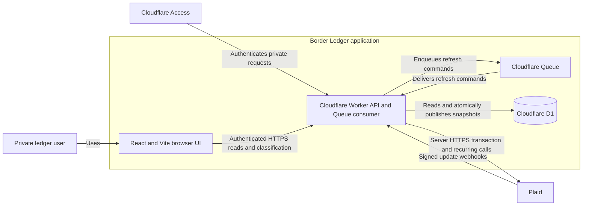

# Plaid recurring analysis: proposed design

Date: 2026-10-13. Status: proposed; this round covers investigation and planning only.

## Intent and scope

Help the private Border Ledger user see recurring commitments, identify subscriptions, inspect their supporting transactions, and understand the next expected charges. Preserve the distinction between posted spending and estimates. Transactions and Recurring Transactions access are reported enabled by the user; an end-to-end recurring API call has not yet been verified.

The first release adds a Recurring view, monthly and annual equivalents by currency, next expected payments in a 30-calendar-day window, stream details, local classification, and latest-payment changes. Recurring income is stored and can be inspected separately. Classification values are unclassified, subscription, bill, other, and excluded. A detected recurring outflow starts unclassified; only a user-confirmed classification contributes to the subscription subtotal. All otherwise-eligible outflow classifications except excluded contribute to the overall recurring commitment subtotal.

Payment initiation, merchant cancellation, external notifications, automated CNY statement detection, and a new service deployment are outside this slice. CNY accounts without a supported Plaid feed display their coverage explicitly. The existing ledger remains the authority for actual spending.

## Evidence and constraints

- Chrome smoke test at https://pf.lofuyu.com: public page, workspace entry, Transactions, Import & review, Accounts & settings, and Sandbox Plaid Link launch responded. After hydration, Transactions displayed zero records and both visible accounts were import-only. Link was exited before account authorization, so ingestion, webhook delivery, and Recurring entitlement remain unverified.
- Current-source tests ran in an isolated local snapshot, with cached dependencies whose package-lock hash matched the workspace: 11 test files and all 36 tests passed; TypeScript checking and Vite build exited 0. JSDOM emitted its navigation limitation warning. The WebDAV checkout itself cannot run the npm scripts because Windows CMD rejects its UNC working directory and its Vitest executable is absent.
- worker/index.ts requests only Transactions, queues transaction synchronization, and treats all known-item TRANSACTIONS webhooks alike. There is no recurring API call, recurring schema, or recurring UI.
- worker/plaid.ts retains a pending ID as the local identity when a transaction posts. The subsequent removal loop in worker/index.ts can delete that posted replacement, and there is no preserved current provider ID for joining recurring history. This is a code-inferred risk requiring a regression test, not a live incident claim.
- src/App.tsx initially uses demo records, silently retains them on API failure, and uses reporting dates fixed to 2026-10-12. Several chart, review, percentage, and sync-age labels remain static after hydration. These undermine trustworthy analysis and require a focused correction.
- React 18.3.1, TypeScript 5.6.3, Vite 8.3.4, Vitest 5.0.4, Wrangler 4.149.0, Cloudflare Workers, D1, and Queues are the established stack. Preserve it.
- CAD and CNY stay separate. Store signed integer minor units; preserve provider calendar dates. Default reporting timezone is America/Toronto, with the existing Asia/Shanghai choice and Monday/Sunday week-start setting.
- Access authentication, same-origin mutation checks, encrypted Plaid tokens, signed webhook verification, API no-store headers, selected-account filtering, and ledger-history preservation on disconnect remain required boundaries.
- The default and production Wrangler environments currently reference the same D1 ID and Queue name. Separate their state before any production bank rollout.

## Plaid integration decisions

Keep products: ['transactions']; Recurring is an add-on fetched through /transactions/recurring/get. New Items will request transactions.days_requested: 730 to support annual analysis, while the UI reports actual available history. Start the first recurring fetch after historical transaction retrieval completes, and route RECURRING_TRANSACTIONS_UPDATE to a recurring refresh. Preserve existing Items' original lookback; deeper coverage requires an optional user-driven reconnection. [Transactions API](https://plaid.com/docs/api/products/transactions/#transactionsrecurringget), [Link configuration](https://plaid.com/docs/api/link/#linktokencreate-request-transactions-days_requested)

Use Sandbox Studio to inspect test Items and requests. Its configuration affects Studio calls, so the application's Worker payload must be changed independently. Use user_transactions_dynamic for provider integration coverage and custom CAD users for controlled history; keep application-level fixtures deterministic. [Sandbox Studio](https://plaid.com/docs/sandbox/studio/), [Transactions testing](https://plaid.com/docs/transactions/transactions-data/)

## Architecture decision

Decision owner: the user approves the product scope; the implementing engineer owns delivery. Codex proposes the design and verification contracts here. Backend, frontend, data, and platform responsibilities are listed below and may be handled by one engineer.

| Option | Benefit | Cost and failure behavior | Decision |
|---|---|---|---|
| Fetch Plaid during each browser read | Few stored projections | Provider latency and outages block the UI; repeated provider calls; no durable last-good view | Rejected |
| Extend the existing Worker with queued D1 snapshots | Reuses token, identity, queue, and ledger boundaries; fast private reads | Eventual consistency and explicit freshness/retry state are required | Recommended |
| Separate recurring service or custom recurrence engine | Independent scaling or non-Plaid detection | Additional operations, data coordination, and detection uncertainty without a demonstrated need | Deferred |

Choose availability of the last successful snapshot during provider failure, with visible stale/error status. A valid snapshot and its membership changes publish atomically; an incomplete response never publishes a misleading zero. Cloudflare documents D1 batch rollback behavior. [D1 batch API](https://developers.cloudflare.com/d1/worker-api/d1-database/#batch)

### Container view

Audience: an implementing engineer locating the private read path and asynchronous refresh boundary. This is a proposed C4 container view expressed as standard Mermaid flowchart syntax. Read the browser path first, then provider updates and persistence. All arrows name interactions; meaning does not depend on color. Exact provider capability and production resource isolation are the remaining deployment uncertainties.

Text fallback: the browser reads sanitized private data from the Worker. The Worker authenticates with Access, verifies Plaid webhooks, queues work, calls Plaid server-side, and stores snapshots in D1. The same Worker consumes the Queue. The UI never calls Plaid's data APIs or receives access tokens.

### Ownership and data contracts

- Plaid owns detection, source status, frequency, membership, and predicted dates. The application owns user classification and estimate presentation. Detection does not establish a merchant contract or cancellation state.
- Add current provider transaction ID, pending provider ID, and Item ID to stored Plaid transactions. Keep the existing local record identity. Resolve an existing current provider ID before falling back to its pending ID, so a later modification without a pending ID still updates the same row. Upserts set the current provider ID; removals match that ID, so removal of a former pending record cannot delete its posted replacement. Join recurring membership by Item and current provider ID. Backfill only identities that are known; a safe replay through the existing upsert path fills gaps without clearing history or changing Item lookback.
- Add recurring_streams keyed by a local ID and unique (item_id, stream_id), recurring_stream_transactions keyed by stream and provider transaction ID, recurring_classifications, and recurring_sync_state. Streams and user classification use separate writes so refreshes preserve choices.
- Store source direction, category/version, original stream status and active flag, dates, frequency, signed amounts, source updated_datetime, local checked time, and presence in the latest successful snapshot. Retain unresolved membership references until the ledger catches up. Use SQLite-compatible constraints and targeted indexes; avoid PostgreSQL-specific features.
- Sync state tracks history completion, requested/completed refresh generations, last success, source time, and a sanitized error code. Increment the requested generation for new demand; a consumer completes only the generation it read before fetching. Demand arriving during a fetch therefore survives its commit. An Item account-scope version fences publication when approved mappings change. Freshness is stale after a refresh failure or more than 24 hours since the last successful check. Keep source time and checked time distinct.

### Runtime and failure contract

1. After exchange, queue the existing Transactions sync. Commit its cursor and changes together. Persist historical completion and recurring refresh demand before follow-up work.
2. Verified SYNC_UPDATES_AVAILABLE queues transaction work; historical completion requests the first recurring snapshot. Verified RECURRING_TRANSACTIONS_UPDATE requests a recurring snapshot. Ignore unrelated codes, unknown Items, and wrong environments. Retain compatibility with queued plaid-sync messages from the previous deployment.
3. A refresh reads the current approved account mapping and supplies only those provider account IDs. Bound each recurring provider request to 30 seconds, then abort and record a retryable timeout. Validate the complete response, direction, currency, and Item scope. Recheck Item existence and approved scope when publishing; disconnect or account removal cannot resurrect data.
4. Publish stream upserts, membership replacement, latest-snapshot presence, and success state in one D1 batch, with the Item lifecycle, account-scope version, and fetched generation checked by the writes themselves. A valid empty full snapshot records no streams. A failure preserves the previous snapshot and refresh demand. Older provider timestamps cannot replace newer data. An equal timestamp can publish under a newer requested generation, including an approved scope change. Completed generations never republish after duplicate delivery. A missing/null source timestamp is not publishable: show waiting-for-data before the first snapshot, or keep the last snapshot with an error afterward.
5. Keep transaction and recurring success independent. Recurring failure does not undo a committed transaction cursor. Retry transient failures using Queue policy, preserve demand on enqueue failure, and expose a manual all-data refresh to recover missed delivery. After retry exhaustion, retain actionable state and send work to the environment's dead-letter queue. Acknowledge only after successful durable writes; disconnected Items are terminal no-ops. Manual refresh and operator dead-letter replay are the chosen recovery mechanisms for this single-user release; no scheduled reconciler is included. Document the accepted cost: missed delivery can remain stale until that intervention, which the UI must make visible.
6. Product-unavailable and Item-login errors stop blind retries and show a clear state; early product readiness keeps history-pending state. Log error codes and request IDs rather than tokens or financial response bodies. The operator owns replay from the existing refresh action.
7. Disconnect durably marks the Item disconnecting and advances its scope version before calling Plaid. That fences refresh publication and removes it from forecast reads while retaining the encrypted token for the revocation attempt. After confirmed remote revocation, remove recurring projections, mappings, and credentials together; historical ledger transactions stay available. Remote failure leaves an actionable disconnecting state and a retry action. If revocation succeeds but D1 cleanup fails, do not reactivate the Item: retry cleanup after a definitive already-removed response or operator verification of revocation in Plaid. Ambiguous remote state stays disconnecting. Record a sanitized intent/request ID for the repair runbook. Queue work for a disconnecting, revoked, or absent Item acknowledges without republishing.

## Analysis and UI contract

- RecurringStream is a sanitized DTO with local ID, account, direction, classification, source state, signed average/last amounts, currency, dates, membership coverage, and freshness. API list and detail pages use stable cursors, default page size 50, and maximum 100. Summary queries run over all qualifying database rows, never the existing 500-row browser ledger limit. The summary request carries startDate, endDate, and the allowed reporting timezone plus account/currency/classification filters; the Worker derives today from its clock in that timezone. The pure estimate result is RecurringEstimateSummary; the repository combines it with queried actual costs and coverage as RecurringSummary.
- GET /api/recurring returns filtered streams; GET /api/recurring/summary returns currency-separated analysis; GET /api/recurring/:id returns paginated supporting history; PATCH /api/recurring/:id/classification stores a validated local choice. Extend POST /api/plaid/sync with optional scope transactions, recurring, or all; omitted scope means all while preserving its current response fields.
- Default estimated commitments include current, active, mature outflow streams with known frequency, supported currency, a confirmed expense/fee link, and no transfer/refund ambiguity. Exclude early, unknown, inactive, tombstoned, unresolved, and user-excluded streams from default totals while keeping them reviewable with reasons.
- Use the provider average_amount for commitment equivalents. Compute monthly equivalents using 52/12 for weekly, 26/12 for biweekly, 2 for semi-monthly, 1 for monthly, and 1/12 for annual. Compute annual equivalents directly using 52, 26, 24, 12, and 1, without multiplying rounded monthly amounts. Unknown frequency returns null. Round once per displayed stream estimate and sum the displayed minor-unit values.
- Use the provider last_amount as the estimated amount of one next charge per stream falling between today and today plus 29 calendar days, inclusive. Label its subtotal 'Next expected payments' and explain that it is not a full 30-day cash-flow forecast. A missing or past predicted date stays unknown/overdue; do not invent a date.
- Show actual linked posted spending separately using distinct ledger transactions, including only membership-linked refund adjustments and excluding transfers. Expenses/fees are negative in the ledger and refunds are positive; negate their sum for a displayed net cost, without clamping a refund-dominated result. Preserve posted dates for the selected window. Never create ledger transactions for forecasts or add expected amounts to confirmed spending.
- Label differences as 'Latest payment changed', not proof of a merchant price change. Derive the difference from the two latest distinct dated posted expense/fee members within the same currency and stream. Require two resolved records and a later posted date; do not invent a prior amount from an average. Response replay or refresh alone must not generate a change.
- Reuse the existing visual system. Add desktop and mobile Recurring navigation, currency/account/classification filters, summary rows, an upcoming list, stream details, and persistent classification controls. Surface loading, no connected feed, waiting for history, ready with no streams, stale/error, unavailable product, and incomplete coverage as distinct states.
- Replace workspace demo fallback with explicit loading/empty/error behavior, derive reporting windows from an injected clock and settings, and compute or suppress static example metrics. Keep the public landing-page examples labeled representative. No private data persistence is added to browser storage.
- Coverage reports requestedDays (nullable for legacy Items), historyFetchComplete, oldestObservedDate, latestObservedDate, linked-record count, and unresolved-member count. Observed dates do not prove continuous bank history. Completed history retrieval does not promise 730 days of records; a mature annual stream remains usable when its actual linked evidence qualifies. Empty results say 'No recurring streams detected in the returned history'. This release provides deeper-history reconnection guidance, not an automatic or new reconnection flow.

## Prioritized verification scenarios

| Scenario | Observable result | Owner |
|---|---|---|
| Duplicate webhook and Queue retry | Same stream count, amounts, memberships, and classifications after replay | Backend |
| Pending removal plus posted addition in one sync | Exactly one confirmed transaction survives and recurring history resolves to it | Backend/data |
| Provider error, malformed snapshot, or D1 failure | Last-good projection remains; success time is unchanged; demand/error state is visible | Backend/data |
| Refresh races disconnect or account scope change | No unapproved stream or restored connection appears | Backend/security |
| Transfer, salary, refund, early stream, unknown frequency | Correct separate grouping or explicit exclusion; no inflated expense total | Domain/backend |
| CAD and CNY, annual cadence, leap day, timezone boundary | Separate integer totals and explainable calendar dates | Domain/frontend |
| Empty, inaccessible, or insufficient data | Clear coverage/readiness state, never an inferred 'no subscriptions' | Frontend |
| More than 500 relevant transactions or many streams | Paginated history and complete summary without silent truncation | Data/API |

## Handoff and remaining evidence

Architecture and API boundaries are proposed above. Backend owns Plaid translation, queue orchestration, and projection publication; data owns migration and query evidence; frontend owns reporting and interaction states; platform owns isolated environments, dead-letter queues, and rollout. The user remains the scope and deployment decision owner.

Before rollout, exercise Sandbox Studio plus the actual application flow through authenticated API, Queue, D1, recurring reads, classification, replay, and disconnect. Provider-generated recurring output is an integration smoke test; deterministic fixtures prove exact amounts, statuses, and edge cases. A schema-compatible prior Worker and disabled recurring feature flag provide the rollback path. Never automatically recreate a real Item to extend history. No implementation, deployment, account connection, or credential change is authorized for this planning round.

Skills applied: Superpowers brainstorming and writing-plans; software-architecture; Magnus C4 diagramming; wshobson API design principles and SQL optimization patterns; Cloudflare platform guidance; systematic debugging and verification-before-completion.

Builder review returned five material questions about ordering, disconnect recovery, undelivered demand, history coverage, and amount selection. The contracts above resolve them as proposed engineering choices. The user can change these choices when reviewing the plan.
